# Overview de mes projets

> Les outils que j'ai construits avec l'IA, surtout avec Claude Code : d'abord pour le cabinet de gestion de patrimoine où j'ai fait mon stage, puis pour mes études, mon association et mon propre Mac.

Je suis Vianney Dubosc, étudiant en L3 Économie-Finance à la FGES (Lille), en Erasmus à Valence. Je ne suis pas ingénieur : j'ai appris à construire des logiciels par passion, avec l'IA. Ma méthode ne change pas d'un projet à l'autre : je décris le besoin et les règles, Claude Code écrit le code, et je vérifie chaque résultat sur de vrais cas avant de m'en servir.

Chaque projet a sa fiche courte : le problème, ce que fait l'outil, trois ou quatre captures, et comment je l'ai construit.

**18 projets**, dont 8 que j'utilise (ou qu'on utilise) au quotidien.

Toutes les captures sont faites sur des données fictives. Les outils réalisés pour le cabinet sont présentés sans leur code, sans données réelles et sans le nom de ses prestataires.

## Finance et gestion de patrimoine

| Aperçu | Projet |
|---|---|
| <a href="projets/rayon-x">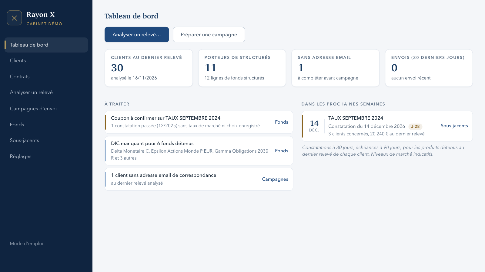</a> | **[Rayon X](projets/rayon-x)** L'outil qui retraite les relevés des assureurs et produit des rapports clients corrigés, avec les fonds structurés réévalués à leur valeur réelle. JavaScript, Electron, ExcelJS, jsPDF · utilisé au quotidien |
| <a href="projets/export-extranet">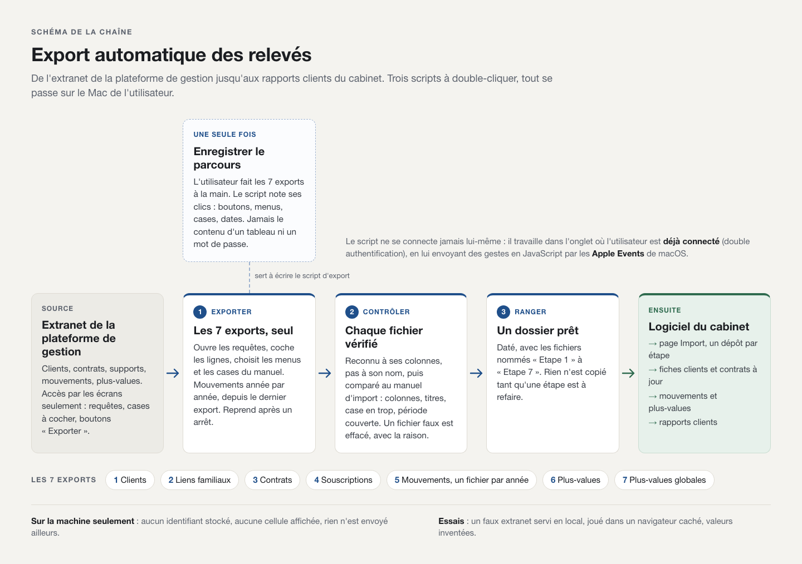</a> | **[Export automatique des relevés](projets/export-extranet)** Des scripts Mac qui pilotent l'extranet d'une plateforme de gestion pour en sortir seuls les 7 relevés du logiciel d'un cabinet, en refusant tout fichier non conforme. Python, JavaScript injecté dans Safari (Apple Events), Electron pour les essais · terminé, utilisé sur le vrai extranet |
| <a href="projets/maquettes-logiciel-cabinet">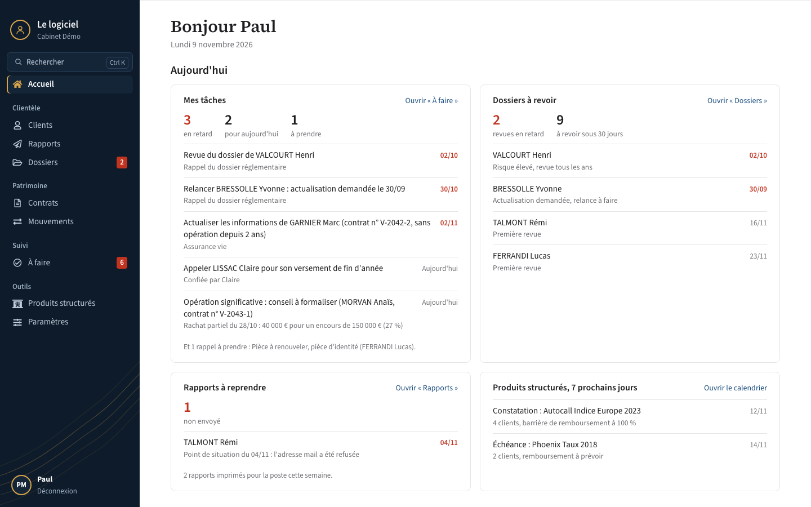</a> | **[Refonte du logiciel d'un cabinet](projets/maquettes-logiciel-cabinet)** Une cinquantaine de maquettes cliquables pour refondre le logiciel interne d'un cabinet de gestion de patrimoine : fiche client, tâches, rapports, dossier réglementaire. HTML, CSS, JavaScript, Python · terminé (maquettes validées, refonte visuelle codée ensuite) |
| <a href="projets/vigie">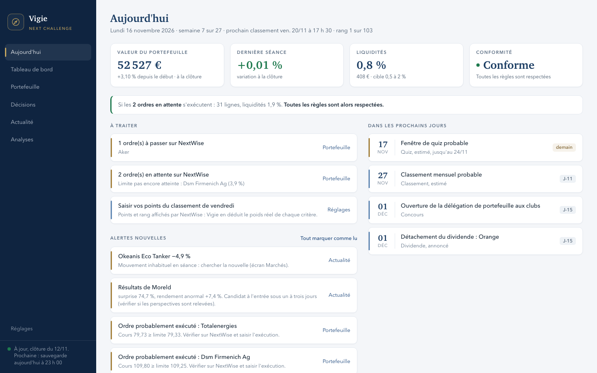</a> | **[Vigie](projets/vigie)** Une aide à la décision sur mon Mac pour le concours de gestion de portefeuille Next Challenge 2026-2027 : elle analyse et prépare, je décide et passe les ordres moi-même. Python, SQLite, Electron, Claude Code · utilisé au quotidien pendant le concours |
| <a href="projets/fges-transaction">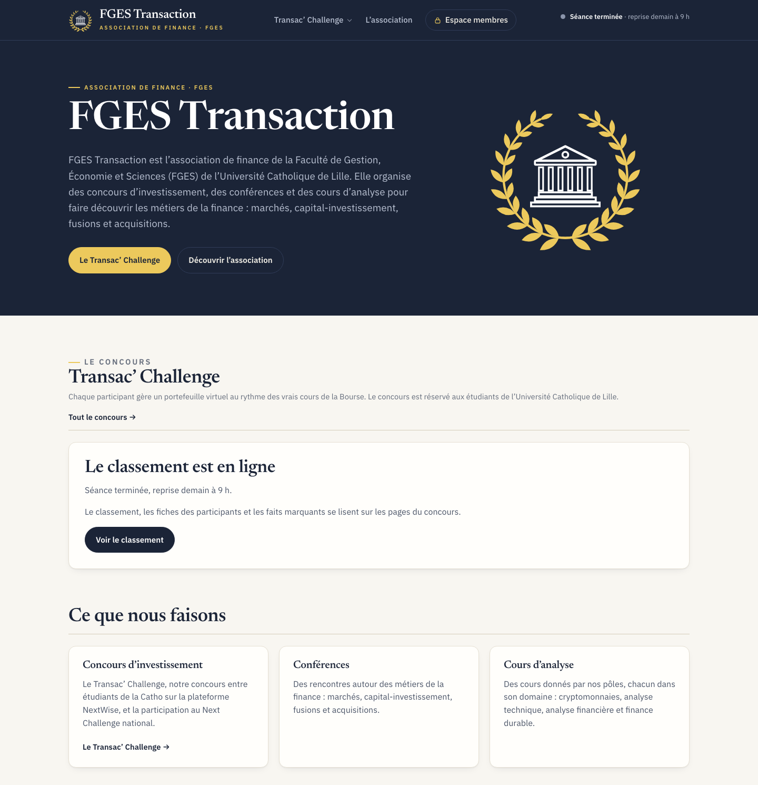</a> | **[FGES Transaction et le Transac’ Challenge](projets/fges-transaction)** Le site de FGES Transaction, l’association étudiante de finance de la FGES (Université Catholique de Lille) dont je fais partie : vitrine, classement en direct de son concours, espace membres. Python (Starlette, Jinja2), SQLite, serveur Debian avec Caddy · en ligne, utilisé par l’association |
| <a href="projets/tracker">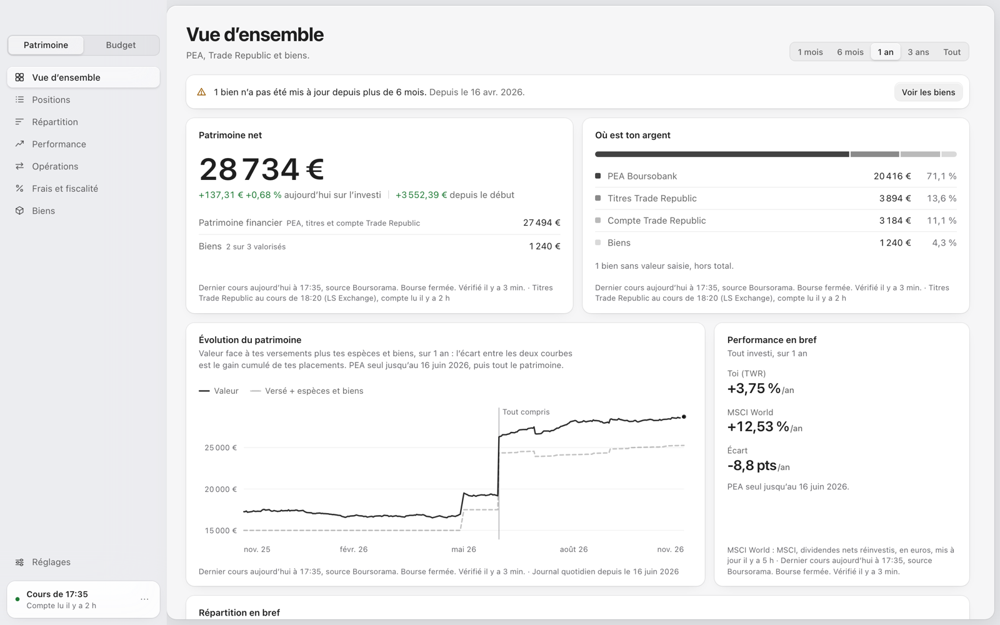</a> | **[Tracker](projets/tracker)** Une app Mac personnelle pour suivre mon patrimoine (PEA, compte-titres, biens) et mes dépenses d'étudiant au même endroit, avec des chiffres justes et datés. Tauri 2 (Rust), JavaScript sans framework, Claude · utilisé plusieurs fois par semaine |
| <a href="projets/forex-z">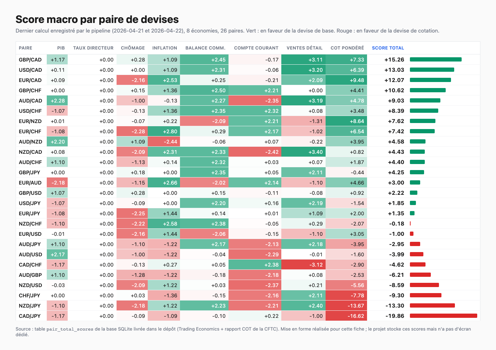</a> | **[FOREX-Z](projets/forex-z)** Un pipeline qui note chaque paire de devises selon les surprises économiques et le positionnement des spéculateurs, avec un tableau de bord pour vérifier si ce score annonce quelque chose. Python, pandas, SQLite, Streamlit / Plotly · prototype à but pédagogique |

## Outils pour travailler avec l'IA

| Aperçu | Projet |
|---|---|
| <a href="projets/fil">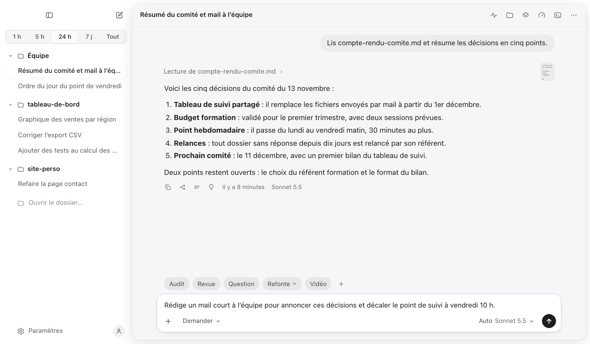</a> | **[Fil](projets/fil)** Mon interface personnelle pour travailler avec les IA : à chaque message, Fil choisit le modèle et la puissance qui suffisent, en ménageant les limites de mon forfait. Electron, React, TypeScript, Claude Agent SDK · utilisé au quotidien |
| <a href="projets/aiguillage">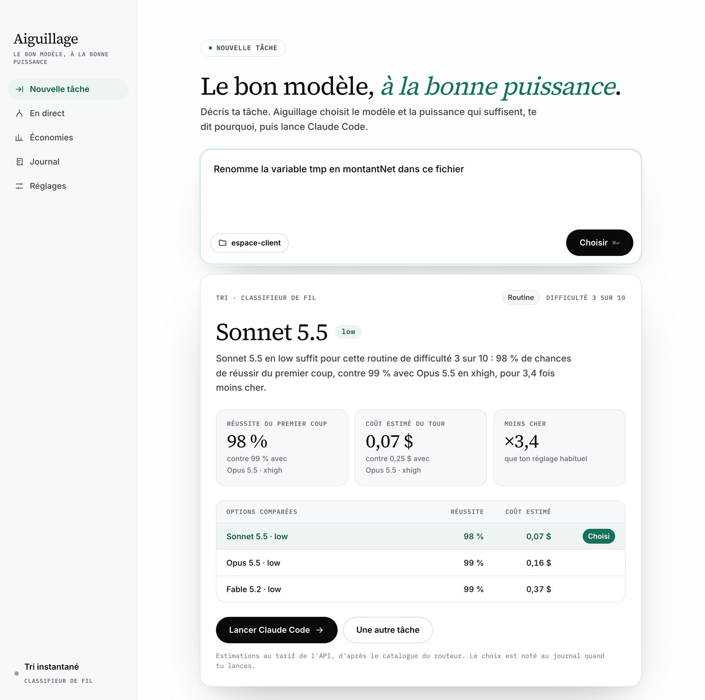</a> | **[Aiguillage](projets/aiguillage)** Pour chaque tâche confiée à Claude Code, Aiguillage choisit le modèle et la puissance qui suffisent, dit pourquoi en une phrase, puis lance Claude Code avec ce choix. TypeScript, Electron + React, Qwen3.6 en local (MLX) · prototype |
| <a href="projets/jauge">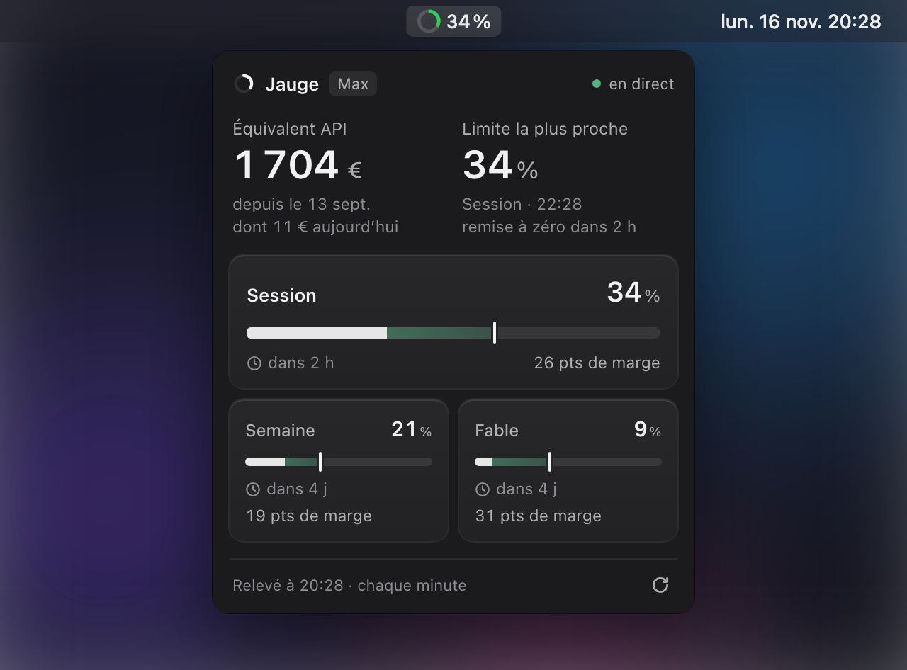</a> | **[Jauge](projets/jauge)** Mes limites d'utilisation de Claude en direct dans la barre des menus du Mac, pour voir d'un coup d'œil si je consomme trop vite. Tauri 2, Rust, HTML/CSS/JavaScript · utilisée au quotidien |
| <a href="projets/claudestats">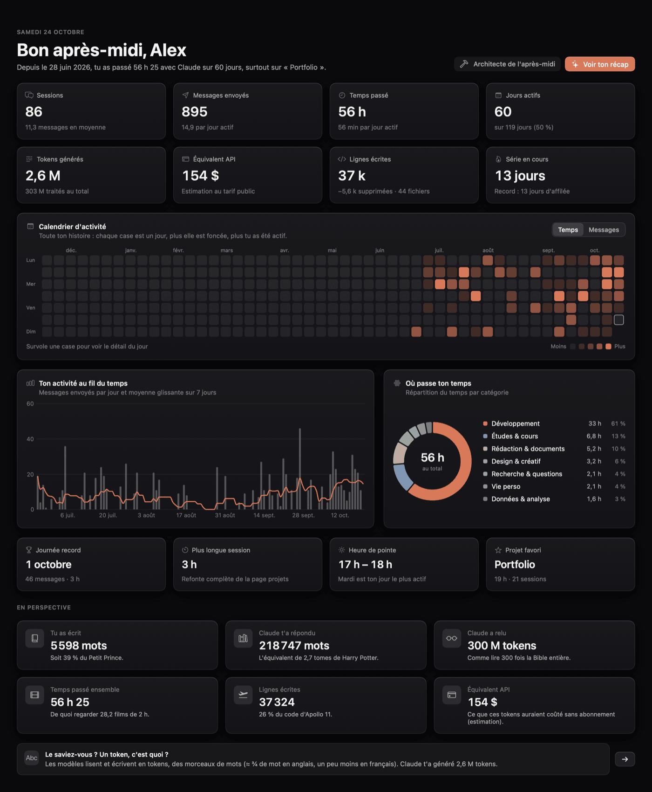</a> | **[ClaudeStats](projets/claudestats)** Une app Mac native qui transforme mes sessions Claude Code et Cowork en tableaux de bord ludiques, calculés en local, pour voir comment je travaille avec l'IA. Swift, SwiftUI, Swift Charts · utilisé au quotidien (v1.1 publiée) |
| <a href="projets/renaissance">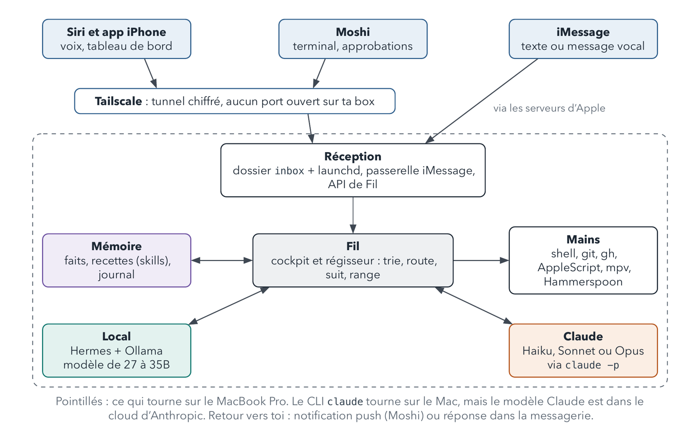</a> | **[Renaissance](projets/renaissance)** Mon assistant IA personnel sur Mac : un modèle local en première ligne, Claude en renfort, pilotable depuis l'iPhone à la voix ou en texte. Ollama (Qwen en local), Claude Code, Python et shell, launchd · en cours (conception terminée, installation commencée) |

## Apps du quotidien

| Aperçu | Projet |
|---|---|
| <a href="projets/sablier">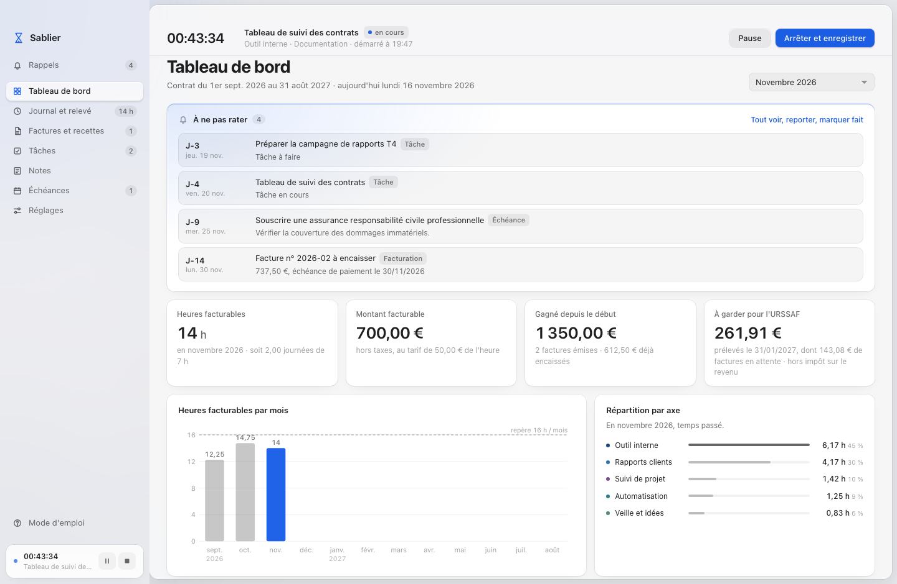</a> | **[Sablier](projets/sablier)** Une app Mac pour suivre ma mission d'indépendant : temps passé, relevé d'activité, facture, tâches et échéances administratives. HTML/CSS/JavaScript sans framework, Rust (Tauri 2), fichiers JSON · utilisé au quotidien |
| <a href="projets/link-me">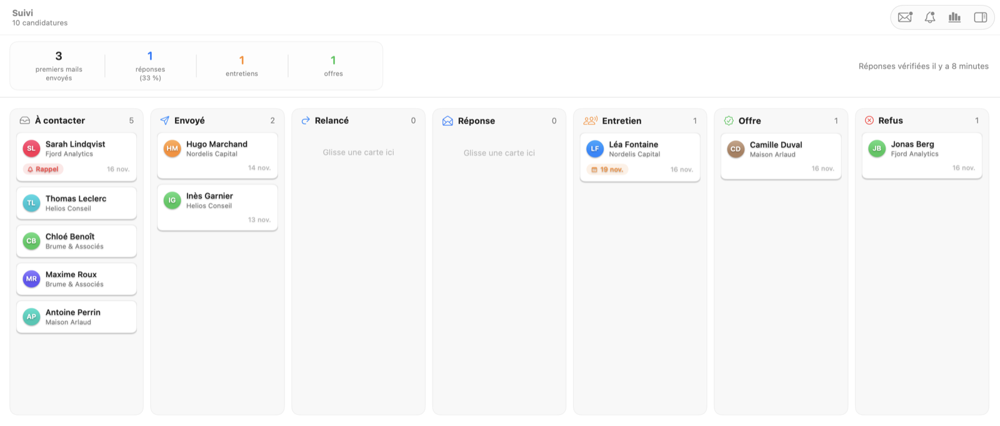</a> | **[Link Me](projets/link-me)** Une app Mac native pour décrocher un stage : elle trouve des contacts LinkedIn, déduit leur e-mail pro, envoie des candidatures personnalisées et suit chaque piste. Swift, SwiftUI (Liquid Glass, macOS 26), Supabase, API Claude · les 5 étapes du cahier des charges sont livrées (v0.1.10) |
| <a href="projets/heartware">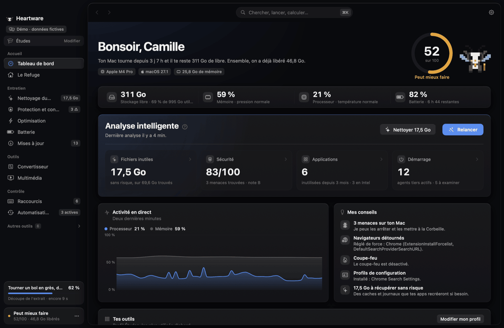</a> | **[Heartware](projets/heartware)** Un utilitaire d'entretien natif pour macOS, gratuit : nettoyage, sécurité, applications, stockage et menu d'état réunis dans une seule app. Swift, SwiftUI, Swift Package Manager · en cours, versions publiées sur GitHub |
| <a href="projets/streamflix">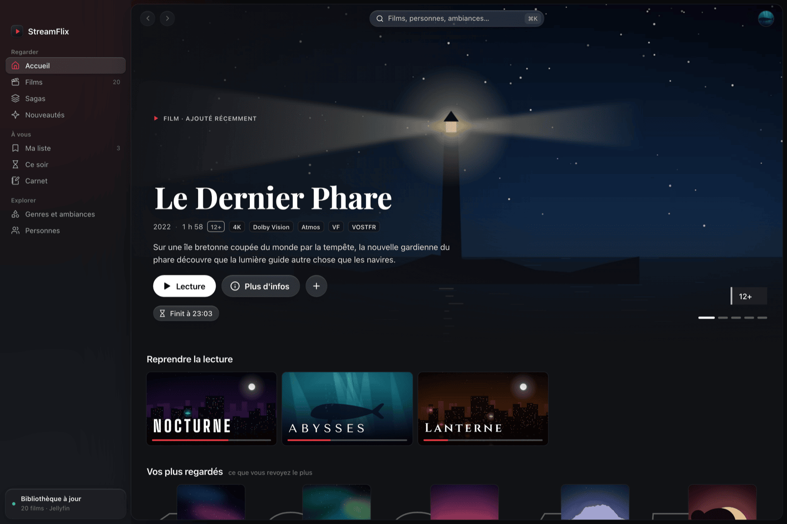</a> | **[StreamFlix](projets/streamflix)** Mon Netflix personnel : une app Mac, Windows et iPhone qui présente et lit ma vidéothèque Jellyfin. React, TypeScript, Tauri, Jellyfin · terminé, utilisé chez moi |
| <a href="projets/befriends">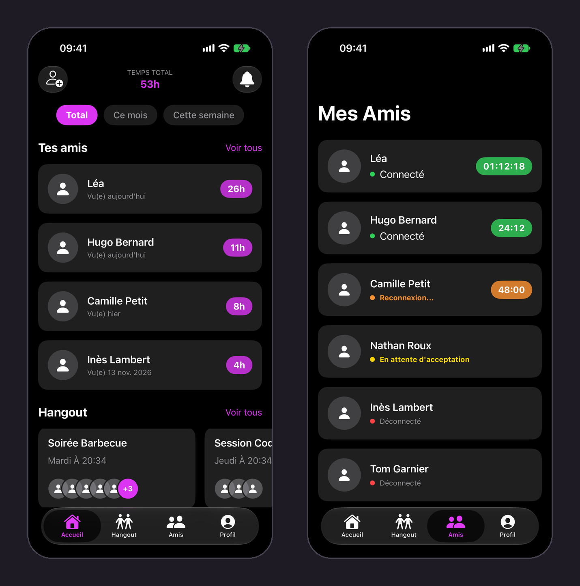</a> | **[Befriends](projets/befriends)** Une app iPhone qui mesure toute seule le temps passé avec chaque ami, en repérant leurs téléphones à proximité par Bluetooth. Swift et SwiftUI, Bluetooth Low Energy (CoreBluetooth), Firebase (connexion Google, base Firestore) · prototype |
| <a href="projets/automatisation-email">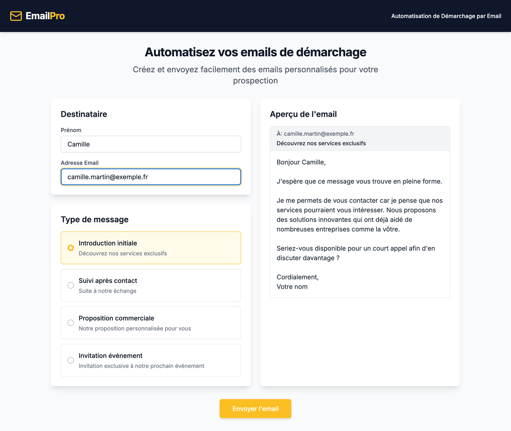</a> | **[Prospection par e-mail automatisée](projets/automatisation-email)** Une petite application web pour envoyer des e-mails de prospection à partir de modèles, personnalisés avec le prénom du destinataire et relus dans un aperçu. React, TypeScript, Tailwind CSS, API SendGrid · prototype |
