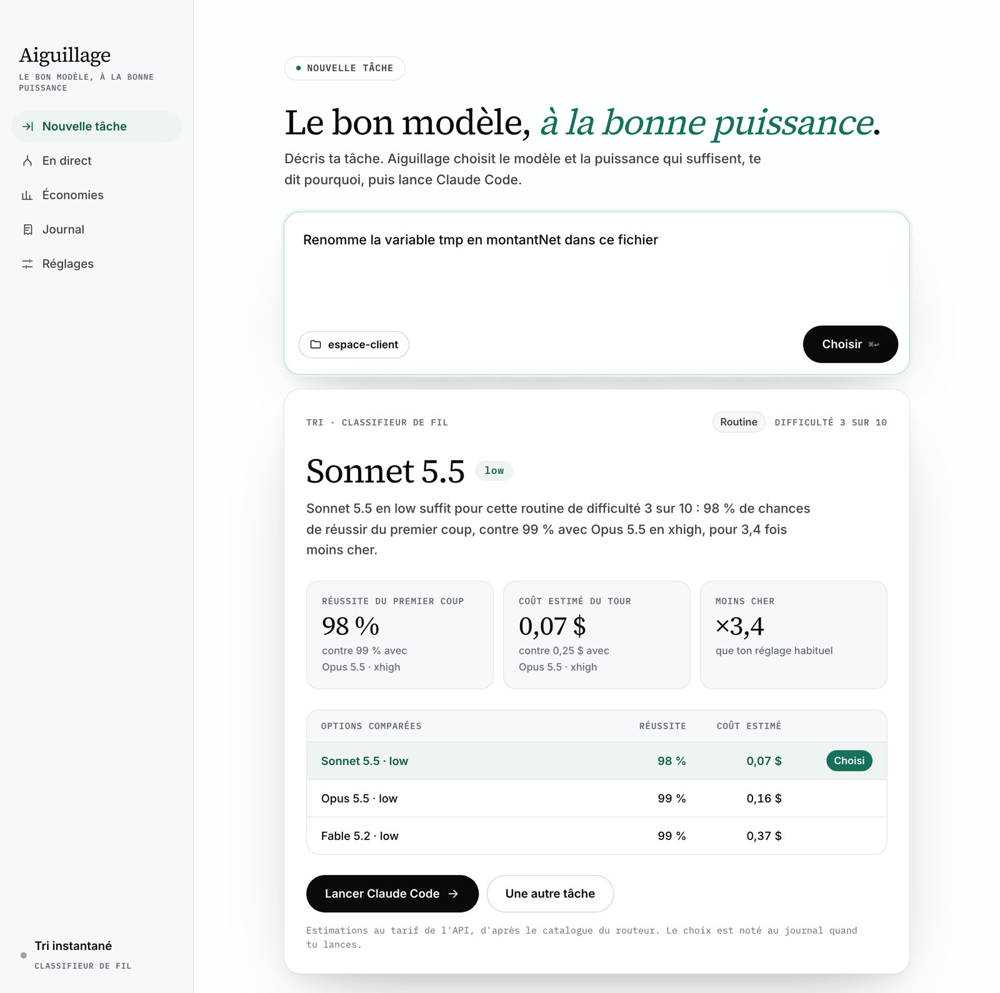
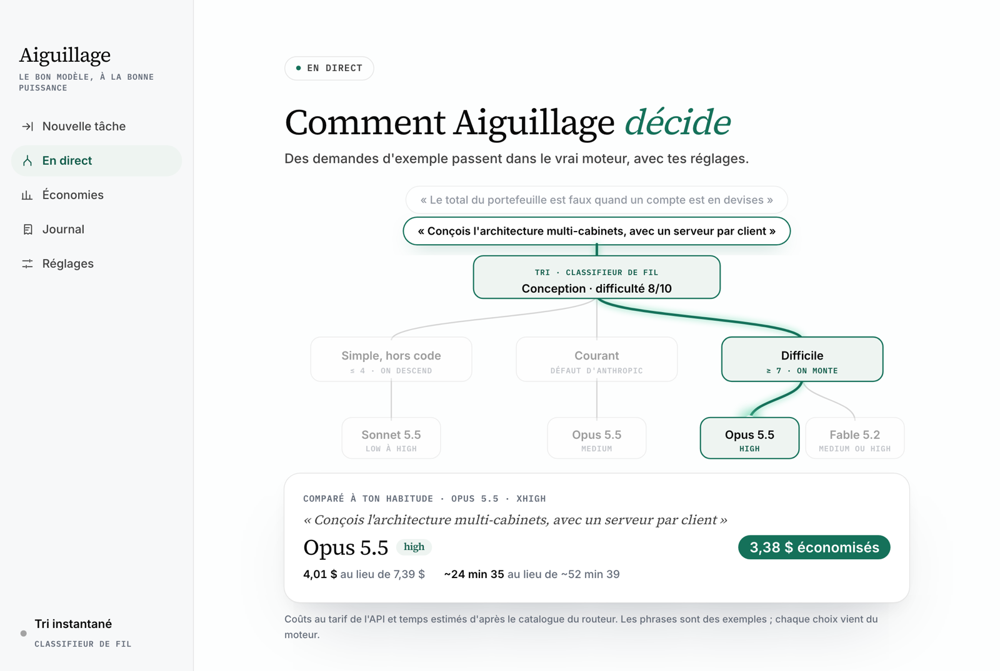
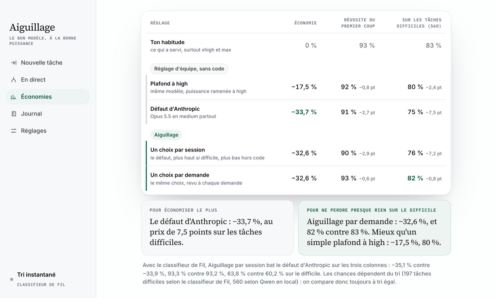
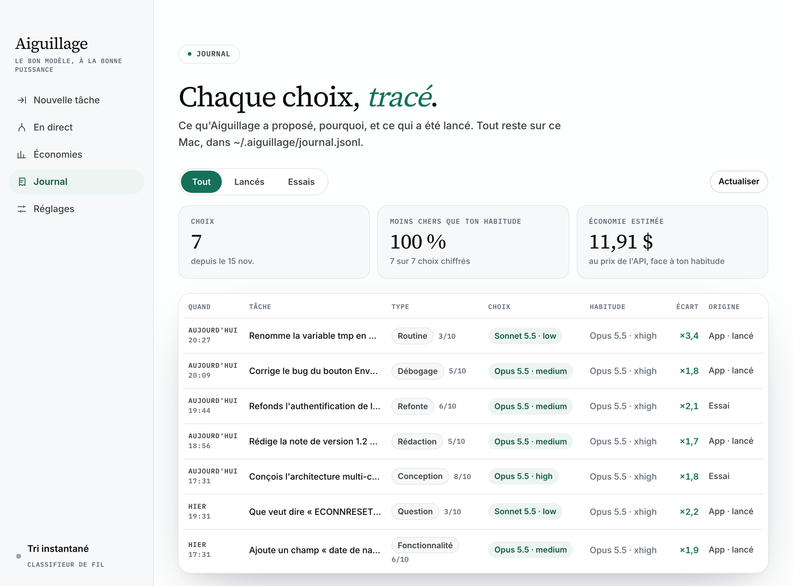

# Aiguillage

> Pour chaque tâche confiée à Claude Code, Aiguillage choisit le modèle et la puissance qui suffisent, dit pourquoi en une phrase, puis lance Claude Code avec ce choix.

**Type** : app Mac et outil en ligne de commande · **Techno** : TypeScript, Electron + React, Qwen3.6 en local (MLX) · **Statut** : prototype · **Période** : novembre 2026

## Le problème
Par habitude, je mettais tout au maximum : sur 1 665 demandes, 91 % étaient parties en xhigh ou max, alors qu'Anthropic conseille Opus en medium. Je voulais chiffrer le coût et choisir mieux.

## Ce que fait l'outil
- **Trie la tâche** (type, difficulté) avec Qwen3.6 en local.
- **Choisit le réglage** : part du défaut d'Anthropic (Opus 5.5 en medium), monte si c'est difficile.
- **Explique le choix** en une phrase ; je peux prendre une autre option.
- **Lance Claude Code** avec ce choix, un seul par session.
- **Rejoue mon historique** pour chiffrer les économies.

## En images
| | |
|---|---|
|  |  |
| En direct | Économies : historique rejoué |

*Journal des choix (tâches d'exemple).*

## Ce que disent les mesures
Historique rejoué, face à mon habitude (83 % de réussite estimée sur les 560 tâches difficiles) :
- **Le gros du gain tient dans un réglage** : Opus en medium partout, −33,7 %, mais 75 % sur le difficile. Un choix par session (le lanceur) fait jeu égal : −32,6 % et 76 %.
- **Un choix revu à chaque demande** : −32,6 % et 82 %. C'est la suite à construire.
- **Qwen trie, il ne remplace pas Claude** : sa réponse suffisait dans 42 % des cas, celle de Claude dans 100 % (33 tâches, jugées par Claude).

Limites : réussites estimées, pas observées, et un seul historique, le mien.

## Comment je l'ai construit
En un week-end avec Claude Code : je décris, il code, je vérifie. Le cœur vient de Fil. Une contrainte a tout décidé : un hook de Claude Code ne peut pas changer de modèle, donc le choix se fait au lancement. Leçon : mesurer avant d'affirmer. Environ 6 700 lignes de TypeScript, dont 1 450 d'exemples étiquetés, et 93 tests.

Code privé, démo possible sur demande.
