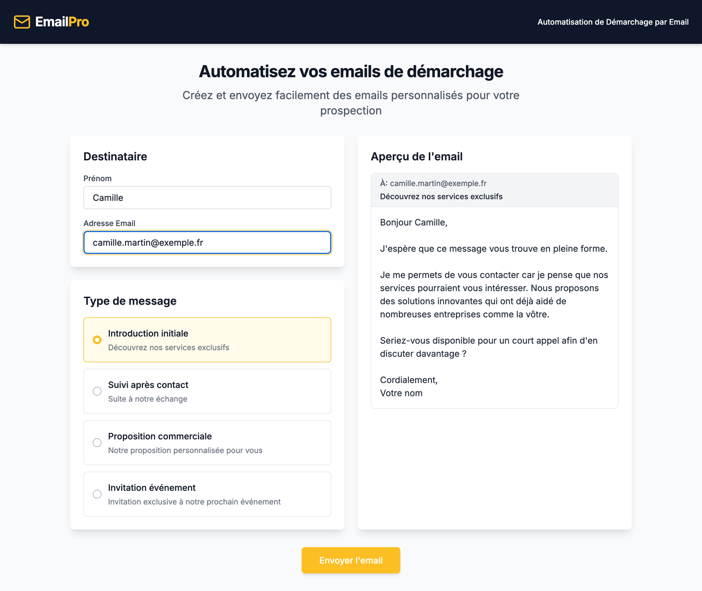
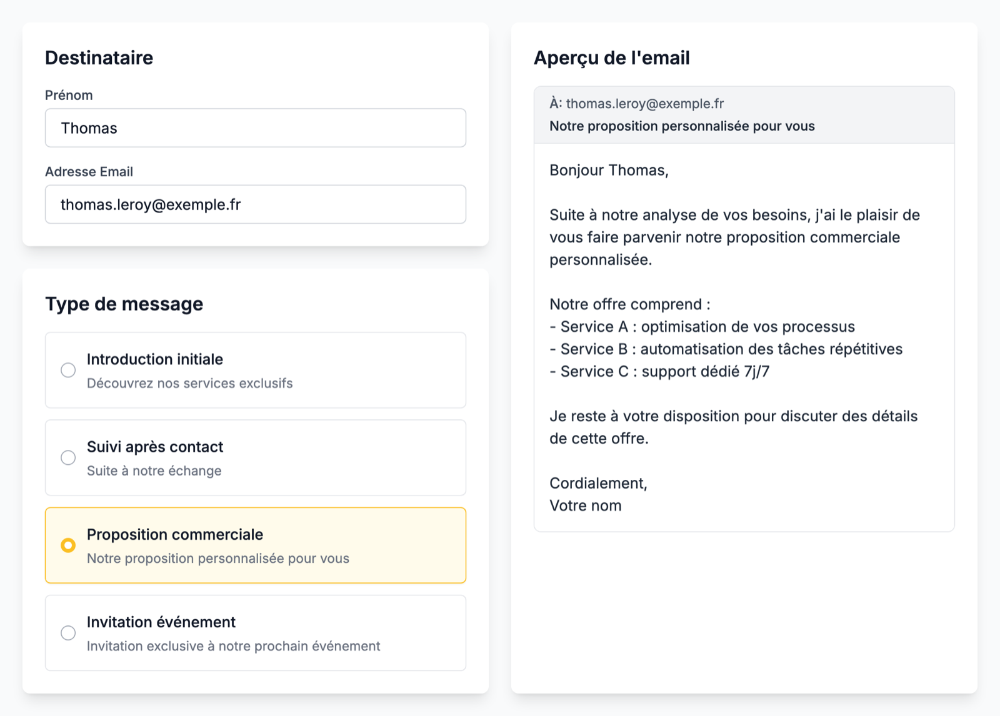
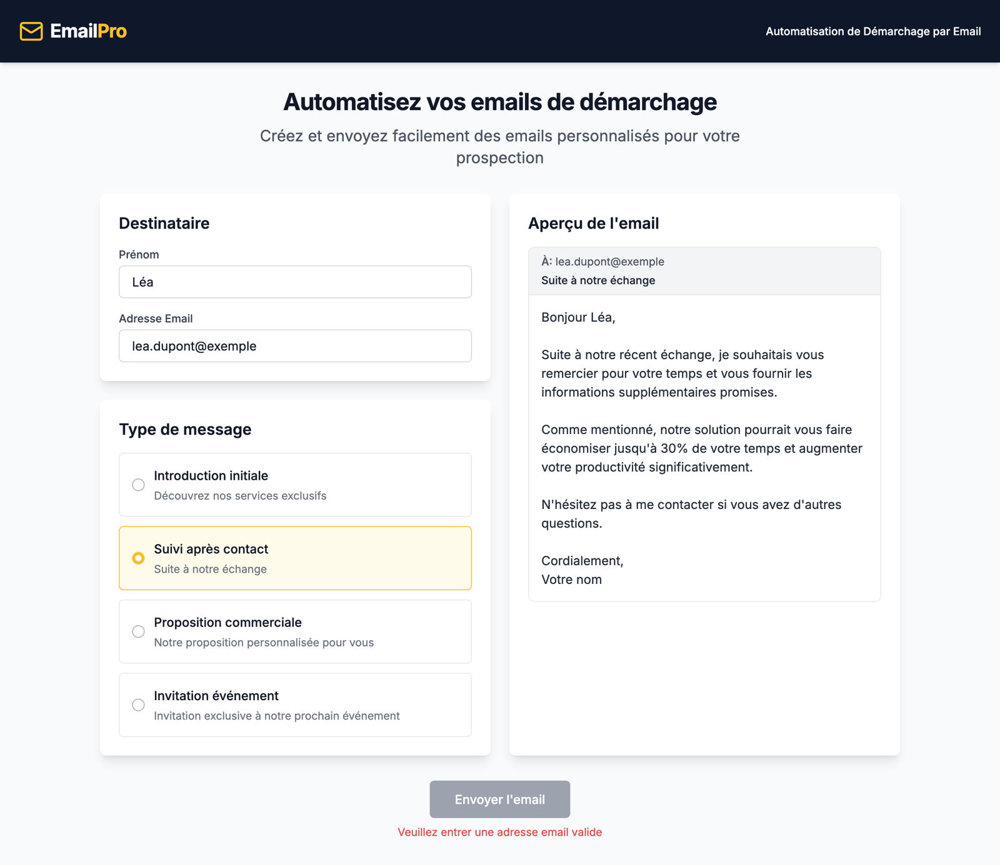
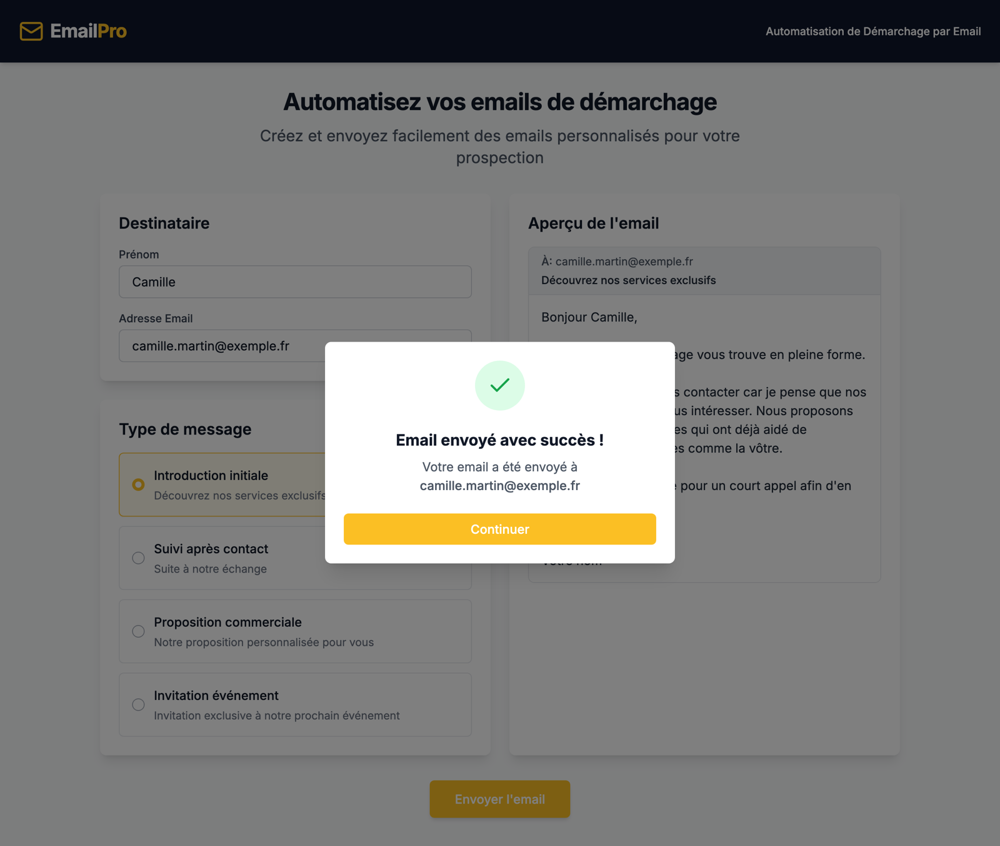

# Prospection par e-mail automatisée

> Une petite application web pour envoyer des e-mails de prospection à partir de modèles prêts à l'emploi, personnalisés avec le prénom du destinataire et relus dans un aperçu avant l'envoi.

**Type** : application web · **Techno** : React, TypeScript, Tailwind CSS, API SendGrid · **Statut** : prototype · **Période** : juin 2025

## Le problème
En prospection, on envoie sans cesse les mêmes types de messages (premier contact, relance, proposition, invitation) en ne changeant que quelques éléments. Les recopier un par un prend du temps et expose aux erreurs : mauvais prénom, adresse mal saisie, mauvais message.

## Ce que fait l'outil
- Propose 4 modèles prêts à l'emploi : introduction, suivi après contact, proposition commerciale, invitation à un événement.
- Insère le prénom du destinataire dans le texte du modèle.
- Affiche en direct l'aperçu exact de l'e-mail : destinataire, objet et corps.
- Bloque l'envoi tant que le prénom manque ou que l'adresse n'a pas un format valide, avec un message qui dit quoi corriger.
- Envoie l'e-mail par l'API SendGrid (expéditeur réglable), puis confirme l'envoi ou affiche l'erreur.

## En images
| | |
|---|---|
|  |  |
| Un autre modèle choisi : l'aperçu suit | Adresse invalide : le bouton d'envoi reste grisé |

*La confirmation après l'envoi (envoi simulé pour la capture : aucun e-mail n'est parti).*

Toutes les captures utilisent des données fictives.

## Comment je l'ai construit
C'est mon projet le plus simple, fait en une journée (5 juin 2025), et il n'a pas été construit avec Claude Code. La première version de l'interface a été déposée d'un bloc sur GitHub, puis j'ai confié les évolutions à Codex, l'agent de code d'OpenAI, en 8 pull requests : le branchement à SendGrid, l'adresse d'expéditeur réglable, les variables d'environnement, une vérification automatique du code (lint et compilation) à chaque modification. L'ensemble tient en environ 550 lignes. Avec le recul, la limite principale est claire : l'appel à SendGrid part directement du navigateur, donc la clé d'API se retrouve dans le code chargé par la page. C'est acceptable pour un essai en local, pas pour un vrai usage : il faudrait un petit serveur qui garde la clé, et des modèles modifiables depuis l'interface plutôt que dans le code.

**Code source** : https://github.com/Olima34/Automatisation-email
