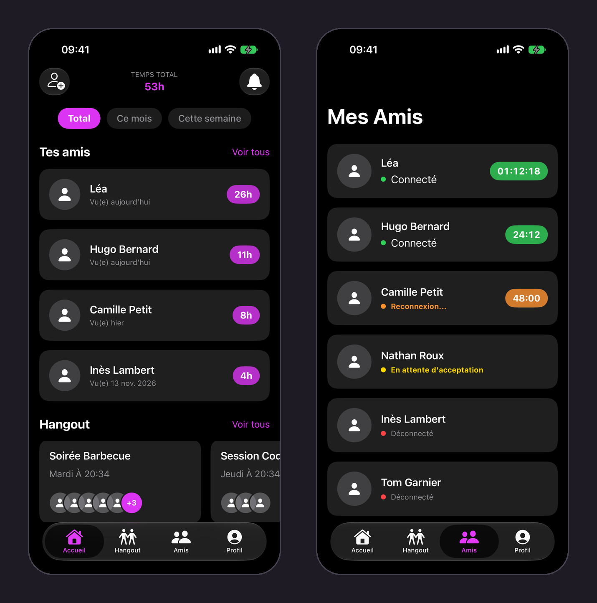
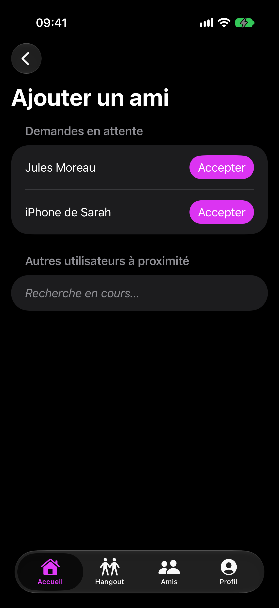

# Befriends

> Une app iPhone qui mesure toute seule le temps passé avec chacun de ses amis, en repérant leurs téléphones à proximité par Bluetooth.

**Type** : app iPhone · **Techno** : Swift et SwiftUI, Bluetooth Low Energy (CoreBluetooth), Firebase (connexion Google, base Firestore) · **Statut** : prototype · **Période** : février – mars 2026

## Le problème
Combien de temps passe-t-on vraiment avec chacun de ses amis ? Personne ne le note, on se fie à son impression. Befriends confie ce travail aux téléphones : quand deux iPhone qui ont l'app sont assez proches pour se capter en Bluetooth, un chronomètre démarre ; quand ils s'éloignent, la session est enregistrée.

## Ce que fait l'outil
- Repère en Bluetooth les iPhone des amis à portée : chaque téléphone émet et écoute en même temps, y compris quand l'app est en arrière-plan.
- Ajout d'un ami en deux temps : un appareil inconnu apparaît dans « Demandes en attente », et la mesure ne démarre que lorsque les deux personnes ont accepté.
- Affiche le statut de chaque ami en direct : connecté (avec le chronomètre), reconnexion (signal perdu depuis moins de 15 min, la session continue), en attente d'acceptation, déconnecté.
- Garde la même durée sur les deux téléphones : chacun envoie régulièrement son compteur à l'autre, et celui qui est en retard s'aligne. La session terminée est enregistrée une seule fois, dans un historique partagé par les deux amis.
- Accueil avec le temps total et le classement des amis par temps passé ensemble (au total, ce mois-ci, cette semaine) ; fiche de chaque ami avec le temps total partagé, l'historique des sessions, le renommage et la suppression de sessions.
- Connexion avec un compte Google pour retrouver ses amis et son historique sur un autre appareil ; notifications quand un ami est à proximité ou qu'un nouvel appareil veut se connecter.

## En images
| | |
|---|---|
|  |  |
| La fiche d'un ami : statut en direct, temps total partagé et historique des sessions | Les appareils détectés à proximité qui attendent d'être acceptés |

Captures prises dans le simulateur iOS avec des amis et des sessions fictifs : le Bluetooth n'y fonctionne pas, la couche Bluetooth et Firebase y est donc remplacée par des données d'exemple ; les écrans sont ceux du code. Les onglets Hangout (les sorties prévues entre amis) et Profil sont restés à l'état d'ébauche : le carrousel Hangout de l'accueil affiche des exemples écrits dans le code.

## Comment je l'ai construit
Je l'ai construit avec Claude Code : je décris le besoin et les règles (quand une session commence, combien de temps attendre avant de la clore, comment deux téléphones se mettent d'accord), Claude Code écrit le code, et je vérifie le résultat. Le Bluetooth ne marche pas dans le simulateur : il faut deux vrais iPhone pour tester. Le plus difficile n'a pas été les écrans, mais tout ce qu'iOS fait dans le dos de l'app : il la met en veille et gèle ses minuteries, change l'adresse Bluetooth du téléphone environ toutes les 15 minutes pour protéger la vie privée, coupe des connexions sans prévenir. L'app reprend donc la main à chaque signal Bluetooth et à chaque retour au premier plan, tolère 15 minutes de coupure avant de clore une session et supprime les fragments de session créés par une micro-coupure. L'ensemble fait environ 2 800 lignes de Swift ; j'en retiens qu'une idée simple à décrire (« compter le temps passé ensemble ») demande beaucoup de règles précises dès que le matériel et le système s'en mêlent.

**Code source** : https://github.com/Olima34/BeFriends — la branche principale a été vidée depuis ; le code complet se trouve dans l'historique, au commit [`d334024`](https://github.com/Olima34/BeFriends/tree/d334024) du 19 mars 2026.
