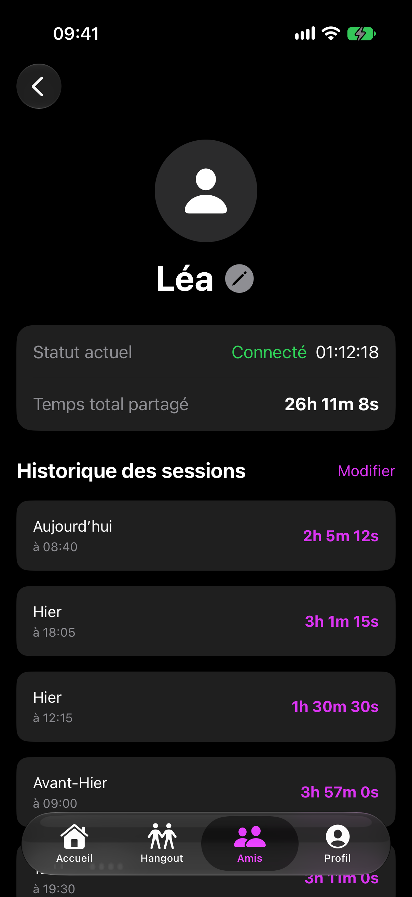

# Befriends

> Une app iPhone qui mesure toute seule le temps passé avec chaque ami, en repérant leurs téléphones à proximité par Bluetooth.

**Type** : app iPhone · **Techno** : Swift et SwiftUI, Bluetooth Low Energy (CoreBluetooth), Firebase (connexion Google, base Firestore) · **Statut** : prototype · **Période** : février – mars 2026

## Le problème
Combien de temps passe-t-on vraiment avec chacun de ses amis ? Personne ne le note. Befriends laisse les téléphones le faire : quand deux iPhone se captent en Bluetooth, un chronomètre démarre ; quand ils s'éloignent, la session est enregistrée.

## Ce que fait l'outil
- Repère en Bluetooth les iPhone des amis à portée, app en arrière-plan comprise ; la mesure ne démarre que lorsque les deux ont accepté.
- Affiche le statut de chaque ami en direct, avec le chronomètre.
- Garde la même durée sur les deux téléphones et enregistre la session une seule fois, dans un historique partagé.
- Classement des amis par temps passé ; connexion Google pour retrouver ses données.

## En images
| | |
|---|---|
|  |  |
| La fiche d'un ami | Appareils en attente d'acceptation |

Captures du simulateur iOS avec des données fictives : le Bluetooth n'y fonctionne pas. Les onglets Hangout et Profil sont restés à l'état d'ébauche.

## Comment je l'ai construit
Je l'ai construit avec Claude Code : je décris le besoin et les règles, Claude Code écrit le code, et je vérifie le résultat ; le test exige deux vrais iPhone. Le plus difficile a été tout ce qu'iOS fait dans le dos de l'app : veille, minuteries gelées, adresse Bluetooth changée environ toutes les 15 minutes. L'app tolère donc 15 minutes de coupure avant de clore une session. L'ensemble fait environ 2 800 lignes de Swift ; j'en retiens qu'une idée simple à décrire demande beaucoup de règles précises dès que le matériel et le système s'en mêlent.

**Code source** : https://github.com/Olima34/BeFriends — la branche principale a été vidée depuis ; le code complet se trouve dans l'historique, au commit [`7eb6f99`](https://github.com/Olima34/BeFriends/tree/7eb6f99) du 19 mars 2026.
