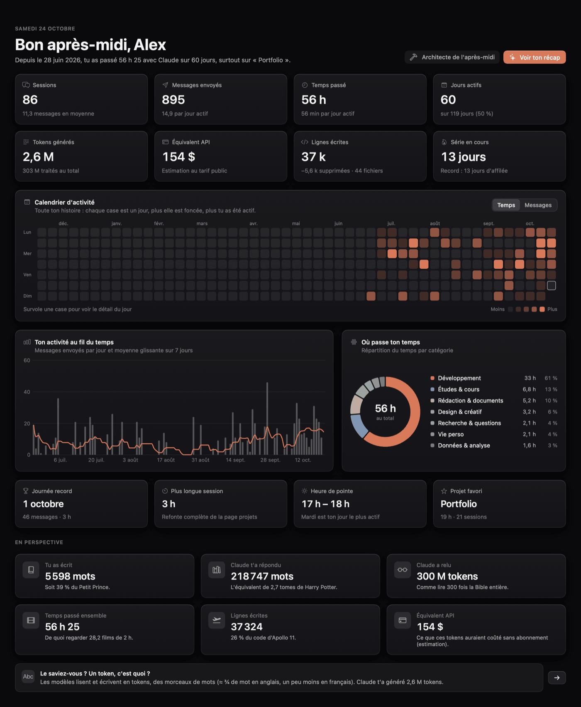
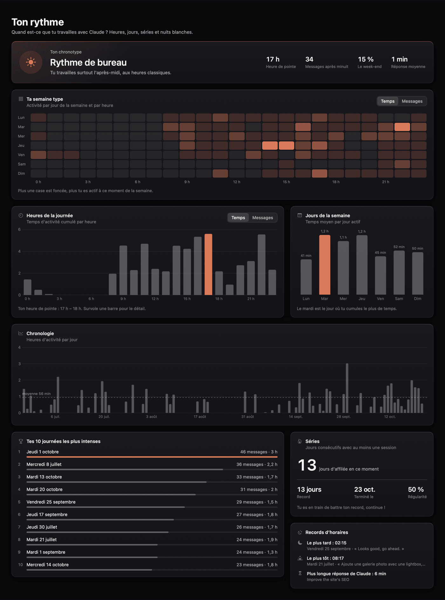
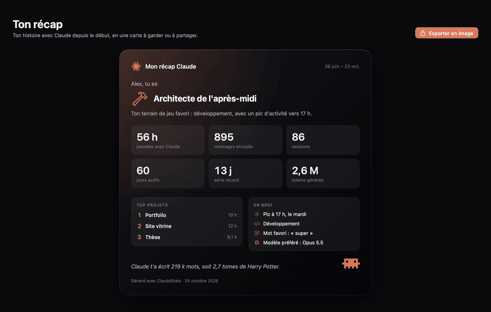

# ClaudeStats

> Une app Mac native qui transforme mes sessions Claude Code et Cowork en tableaux de bord ludiques, calculés en local, pour voir comment je travaille avec l'IA.

**Type** : app Mac · **Techno** : Swift, SwiftUI, Swift Charts · **Statut** : utilisé au quotidien (v1.1 publiée) · **Période** : octobre – novembre 2026

## Le problème
Je passe beaucoup de temps avec Claude Code et Cowork sans vue d'ensemble : combien d'heures, sur quels projets, que fait Claude en coulisses. Ces sessions sont pourtant stockées sur le Mac, dans des fichiers JSONL illisibles.

## Ce que fait l'outil
- Lit les transcripts Claude Code et les sessions Cowork présents sur le Mac ; rien ne quitte l'ordinateur.
- Répartit l'information en onze pages : vue d'ensemble, rythme, projets, catégories, sessions, limites d'usage, badges…
- Montre ce que fait Claude : outils appelés, commandes shell, langages écrits, sous-agents, part des tokens servie par le cache.
- Classe chaque session par catégorie (développement, études, finance…) ; un clic droit corrige une erreur.
- Propose 24 badges, un récap façon « Wrapped » exportable en PNG et une page « Comprendre » (token, contexte, cache) avec mes chiffres.

## En images
| | |
|---|---|
|  |  |
| Rythme : semaine type, heures favorites | Claude au travail : outils, commandes, langages |

*Le récap façon « Wrapped », à garder ou à partager en image.*

Captures réalisées avec les données fictives du mode démo (« Alex »), pas avec mes vraies sessions.

## Comment je l'ai construit
Je l'ai construit avec Claude Code : je décris le besoin et les règles de calcul, Claude Code écrit le code, et je vérifie chaque chiffre sur mes vraies sessions grâce à une commande `--dump`. Le projet compte environ 8 700 lignes de Swift. Difficulté marquante : le temps d'activité n'est enregistré nulle part, il faut le reconstruire (une pause de plus de 15 minutes clôt une période). J'en retiens une compréhension concrète du fonctionnement d'un agent IA.

Projet personnel, sans lien avec Anthropic.

**Code source** : https://github.com/Olima34/ClaudeStats
