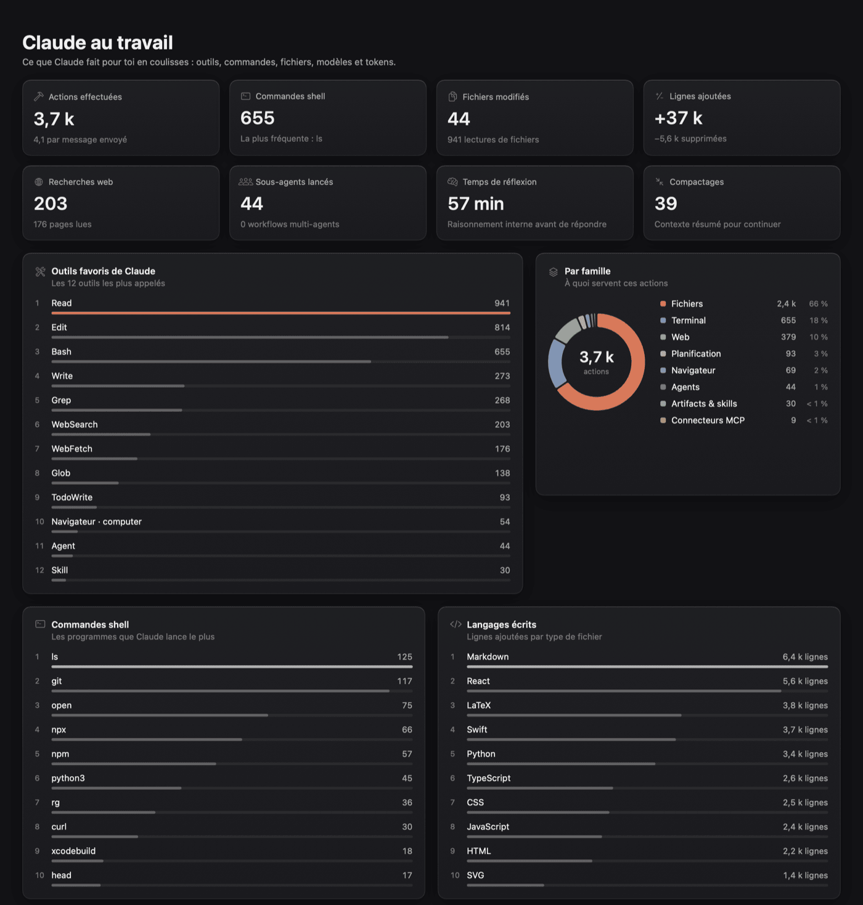

# ClaudeStats

> Une app Mac native qui transforme mes sessions Claude Code et Cowork en tableaux de bord ludiques, calculés entièrement en local, pour voir comment je travaille avec l'IA.

**Type** : app Mac · **Techno** : Swift, SwiftUI, Swift Charts · **Statut** : utilisé au quotidien (v1.1 publiée) · **Période** : octobre – novembre 2026

## Le problème
Je passe beaucoup de temps avec Claude Code et Cowork, sans aucune vue d'ensemble : combien d'heures, sur quels projets, à quelles heures, et ce que Claude fait vraiment en coulisses. Toutes ces sessions sont pourtant stockées sur le Mac, dans des fichiers JSONL illisibles à l'œil nu.

## Ce que fait l'outil
- Lit les transcripts Claude Code, les sessions Cowork et l'historique des limites d'usage présents sur le Mac ; rien ne quitte l'ordinateur.
- Répartit l'information en onze pages : vue d'ensemble, rythme (semaine type, chronotype, séries), projets, catégories, sessions, style d'écriture, limites d'usage, badges…
- Montre ce que fait Claude : outils appelés, commandes shell, langages écrits, fichiers retouchés, sous-agents, modèles, et la part des tokens servie par le cache.
- Classe chaque session dans une catégorie (développement, études, finance, rédaction…) d'après des mots-clés en français, anglais et espagnol, le titre, le dossier et les types de fichiers ; un clic droit corrige une erreur.
- Filtre par période, source et projet ; propose 24 badges, un récap façon « Wrapped » exportable en PNG et un résumé dans la barre des menus.
- Explique les notions de base (token, contexte, cache, compactage) avec mes propres chiffres, page « Comprendre ».

## En images
| | |
|---|---|
|  |  |
| Rythme : semaine type, heures et jours favoris, journées les plus intenses | Claude au travail : actions, outils favoris, commandes shell, langages écrits |

*Le récap façon « Wrapped », à garder ou à partager en image.*

Captures réalisées avec les données fictives du mode démo (« Alex »), pas avec mes vraies sessions.

## Comment je l'ai construit
Je l'ai construit avec Claude Code : je décris le besoin et les règles de calcul, Claude Code écrit le code, et je vérifie chaque chiffre sur mes vraies sessions grâce à une commande `--dump` qui affiche tous les résultats en texte. Le projet compte environ 8 700 lignes de Swift, en trois couches : lecture des fichiers, analyse, interface. Deux difficultés intéressantes : le temps d'activité n'est enregistré nulle part, il faut le reconstruire (une pause de plus de 15 minutes clôt une période) ; et les sessions « forkées » recopient les lignes de leur parente, d'où un dédoublonnage par identifiant. Pour la vitesse, chaque fichier lu est résumé dans un cache : plusieurs gigaoctets de transcripts prennent quelques secondes la première fois, puis une à deux secondes. J'en ai surtout retiré une compréhension concrète du fonctionnement d'un agent IA : contexte relu à chaque message, cache, compactage, sous-agents.

Projet personnel, sans lien avec Anthropic.

**Code source** : https://github.com/Olima34/ClaudeStats
