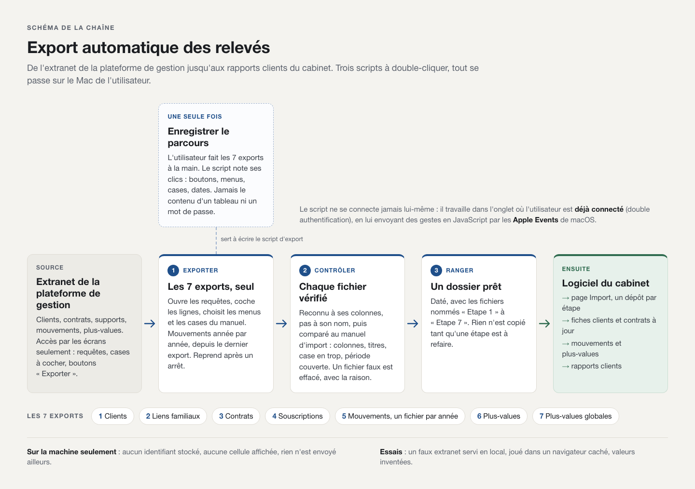
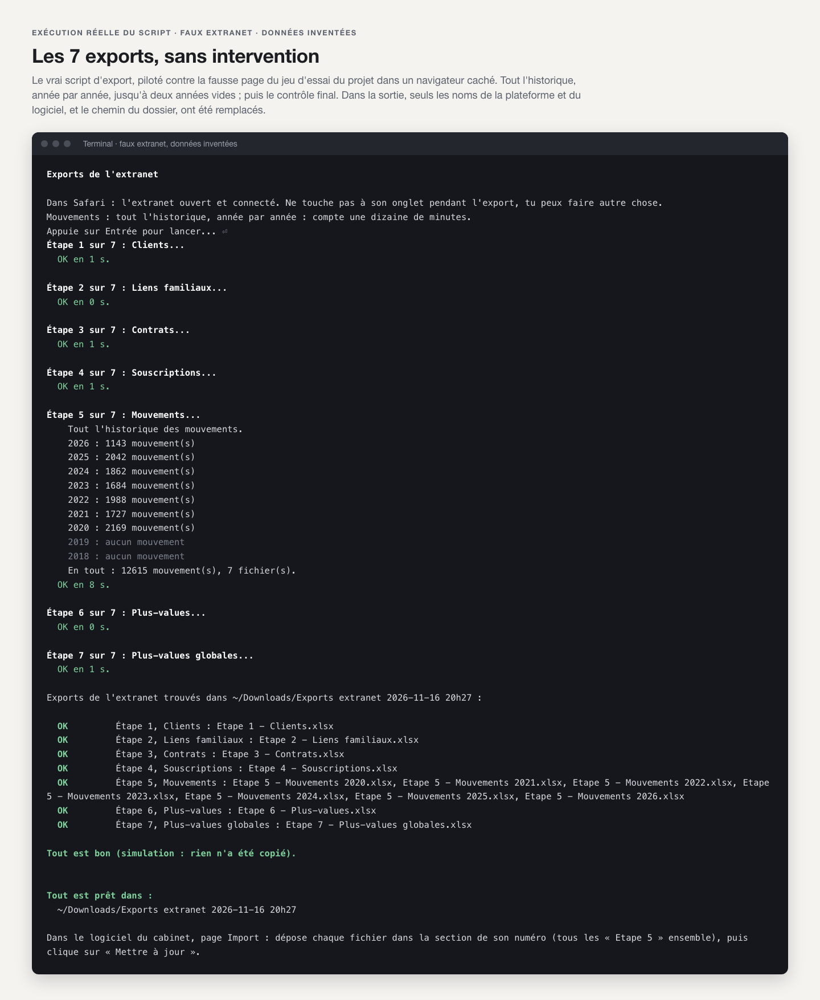
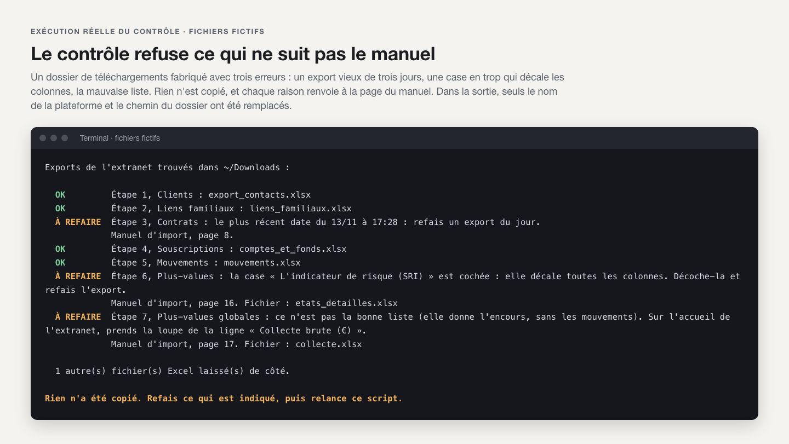
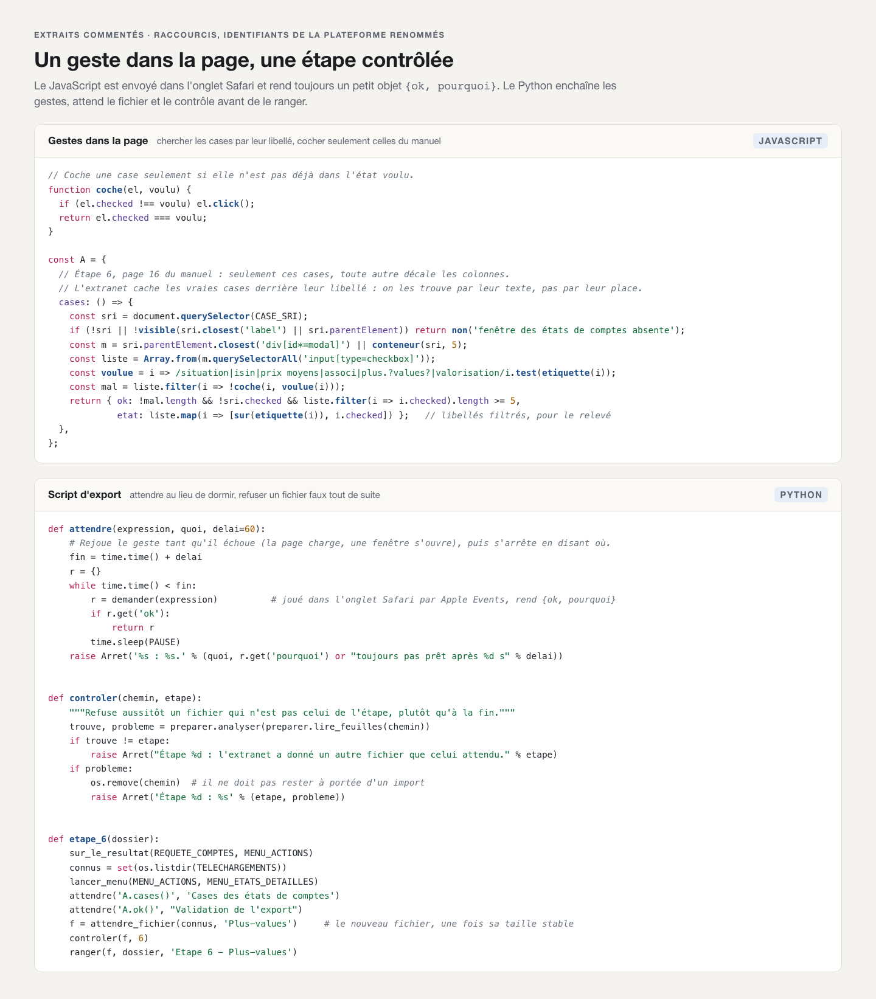

# Export automatique des relevés

> Des scripts Mac qui pilotent l'extranet d'une plateforme de gestion pour en sortir seuls les 7 relevés du logiciel d'un cabinet, en refusant tout fichier non conforme.

**Type** : scripts Mac à double-cliquer · **Techno** : Python, JavaScript injecté dans Safari (Apple Events), Electron pour les essais · **Statut** : terminé, utilisé sur le vrai extranet · **Période** : novembre 2026

## Le problème
Le logiciel du cabinet se met à jour à partir de 7 fichiers Excel à sortir d'un extranet en suivant à la lettre un manuel d'import. Une case de trop décale toutes les colonnes, et l'erreur ne se voit qu'à l'import.

## Ce que fait l'outil
- Fait seul les 7 exports dans l'onglet Safari déjà connecté (double authentification) : aucun identifiant n'est vu ni gardé.
- Reconnaît chaque fichier à ses colonnes et le compare au manuel ; un fichier faux est effacé aussitôt, avec la raison et la page du manuel.
- Range les 7 fichiers dans un dossier daté, prêts à importer, et reprend là où il s'est arrêté.

## En images
| | |
|---|---|
|  |  |
| Exécution sur un faux extranet | Contrôle : trois exports refusés, avec leur raison |

*Extrait commenté du script.*

## Comment je l'ai construit
Avec Claude Code en une semaine : je décris le besoin, il écrit le code, je vérifie chaque résultat sur le vrai extranet. Pour que l'IA ne voie jamais de données de clients, on a procédé en « je clique, tu enregistres » : j'ai fait les exports une fois à la main pendant que l'enregistreur notait la seule structure des écrans. Une première version dans un navigateur à part a été abandonnée : seul mon Safari était connecté.

Résultat : environ 140 000 mouvements sur vingt ans, importés sans erreur, avec 1 250 lignes d'outil et près de 60 vérifications. Ma leçon, qui vaut pour tout agent qui travaille sur l'extranet d'un assureur : un clic qui réussit ne prouve rien, c'est le fichier obtenu qu'il faut vérifier, et le script doit savoir s'arrêter en disant pourquoi.

Code privé (outil d'un cabinet), démo possible sur demande.
