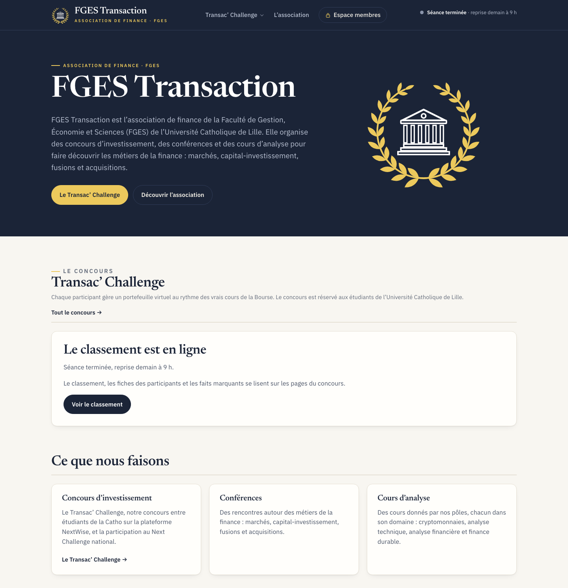

# FGES Transaction et le Transac’ Challenge

> Le site de FGES Transaction, l’association étudiante de finance de la FGES (Université Catholique de Lille) dont je fais partie : vitrine publique, classement en direct de son concours d’investissement et espace réservé aux membres.

**Type** : site web (pages publiques et espace membres) · **Techno** : Python (Starlette, Jinja2), SQLite, serveur Debian avec Caddy · **Statut** : en ligne, utilisé par l’association · **Période** : octobre à novembre 2026

## Le problème
L’association organise le Transac’ Challenge, un concours d’investissement réservé aux étudiants de la Catho : du 5 octobre 2026 au 14 février 2027, chaque participant gère, seul ou en club, un portefeuille virtuel sur l’application NextWise, au rythme des vrais cours de la Bourse. Il fallait un site pour publier le classement à toute l’université, présenter l’association et donner à ses membres un espace commun pour s’organiser.

## Ce que fait l’outil
- **Classement en direct** : pendant chaque séance de Bourse, le site lit toutes les 10 minutes le classement que NextWise lui met à disposition (jamais la nuit ni le week-end), et les pages ouvertes se mettent à jour seules.
- **Une « une » du jour** : podium, chiffres clés, faits marquants calculés à partir des seules données reçues, et la « course » des huit premiers séance après séance.
- **Une fiche par participant** : courbes de performance et de rang, voisins au classement, moments forts ; on peut suivre ses favoris sans créer de compte.
- **Pages publiques** : l’association, le concours (inscription, calendrier), la plateforme NextWise, un agenda auquel s’abonner depuis son téléphone, une page de contact par motif ; mesure d’audience sans cookie ni traceur.
- **Espace membres** protégé par mot de passe et double authentification : agenda des événements avec inscriptions, informations, pôles, annuaire, droits réglés section par section.
- **Exploitation** : sauvegardes, effacement automatique des données selon des durées de conservation déclarées, contrôle de la configuration avant mise en ligne.

## En images

La une du Transac’ Challenge : podium, chiffres du jour et course des huit premiers (données fictives de démonstration).

| | |
|---|---|
|  |  |
| Fiche d’un participant (données fictives) | Page du concours, sur le site en ligne |

## Comment je l’ai construit
Je l’ai construit avec Claude Code, en un mois (170 commits entre le 6 octobre et le 2 novembre 2026) : je décris le besoin et les règles, Claude Code écrit le code, je vérifie chaque page et chaque cas sur le site. Les règles venaient de l’extérieur (règlement du concours, protection des données, accord avec NextWise) : le site ne fait que lire le classement que NextWise lui ouvre, ne collecte rien sur sa plateforme, et les règles principales sont vérifiées par des tests (indicateurs autorisés, vocabulaire, aucune page de classement publiée sans l’interrupteur du bureau). Les graphiques sont des SVG calculés sur le serveur, sans bibliothèque, et le site fonctionne même sans script, et sans aucun cookie pour les visiteurs. Le projet compte environ 30 000 lignes de Python et plus de 1 300 tests automatisés ; il tourne sur un petit serveur loué, avec sauvegardes et documents de passation pour le prochain bureau. J’y ai appris à transformer des règles écrites en garde-fous vérifiés, et ce que demande un site réellement en production.

Code privé, site en ligne : https://fgestransaction.fr
