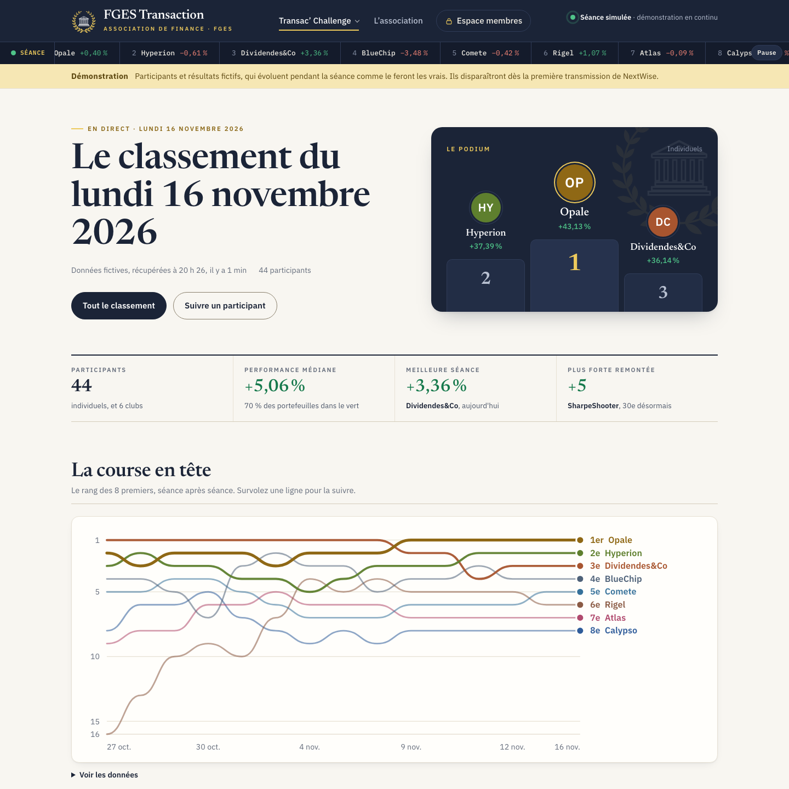
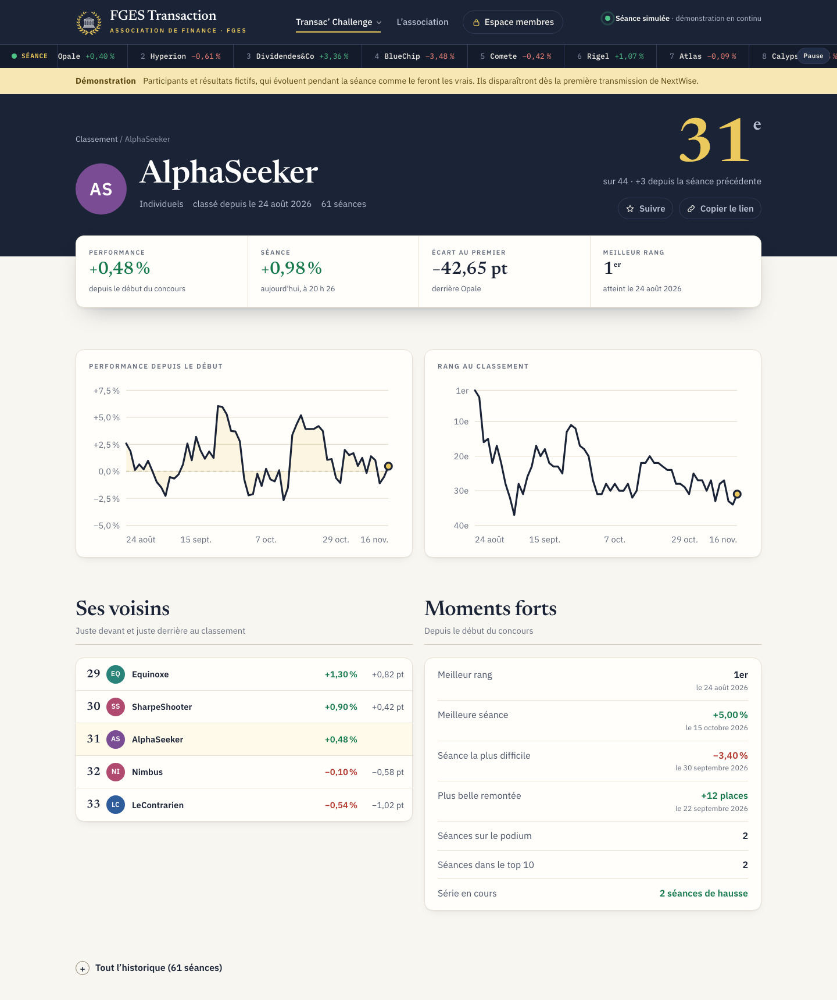
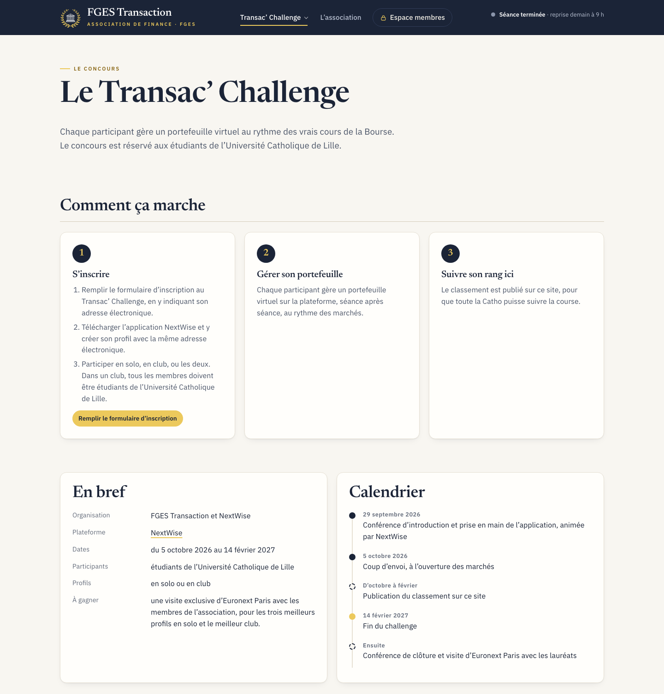

# FGES Transaction et le Transac’ Challenge

> Le site de FGES Transaction, l’association étudiante de finance de la FGES (Université Catholique de Lille) dont je fais partie : vitrine, classement en direct de son concours, espace membres.

**Type** : site web (pages publiques et espace membres) · **Techno** : Python (Starlette, Jinja2), SQLite, serveur Debian avec Caddy · **Statut** : en ligne, utilisé par l’association · **Période** : octobre à novembre 2026

## Le problème
L’association organise le Transac’ Challenge, un concours d’investissement pour les étudiants de la Catho : du 5 octobre 2026 au 14 février 2027, chacun gère un portefeuille virtuel sur NextWise. Il fallait un site pour publier le classement, présenter l’association et réunir les membres.

## Ce que fait l’outil
- **Classement en direct** : pendant la Bourse, le site lit toutes les 10 minutes le classement que NextWise lui met à disposition, et les pages se mettent à jour seules.
- **Une « une » du jour** : podium, chiffres clés et « course » des huit premiers.
- **Une fiche par participant** : courbes de performance et de rang, favoris sans compte.
- **Pages publiques** : l’association, le concours, un agenda ; audience sans cookie ni traceur.
- **Espace membres** protégé par mot de passe et double authentification : événements, inscriptions, annuaire.

## En images

La une du Transac’ Challenge (données fictives de démonstration).

| | |
|---|---|
|  |  |
| Fiche d’un participant (données fictives) | Page du concours, sur le site en ligne |

## Comment je l’ai construit
Je l’ai construit avec Claude Code, en un mois (170 commits) : je décris le besoin et les règles, Claude Code écrit le code, je vérifie chaque page. Les règles venaient de l’extérieur (règlement, protection des données, accord avec NextWise) : le site ne fait que lire le classement que NextWise lui ouvre, et les règles principales sont vérifiées par des tests. Le projet compte environ 30 000 lignes de Python et plus de 1 300 tests. J’y ai appris à transformer des règles écrites en garde-fous vérifiés, et ce que demande un site réellement en production.

Code privé, site en ligne : https://fgestransaction.fr
