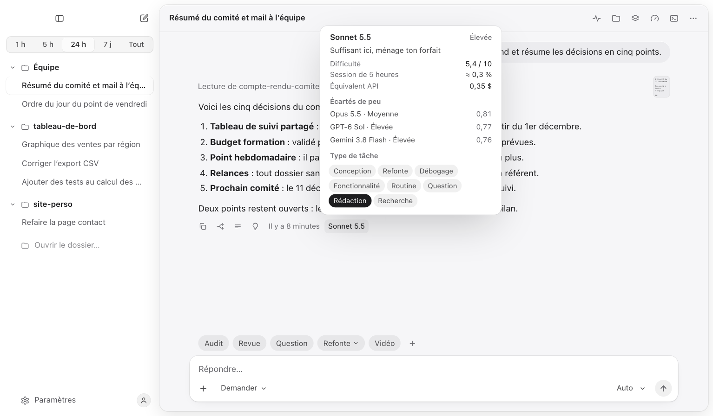
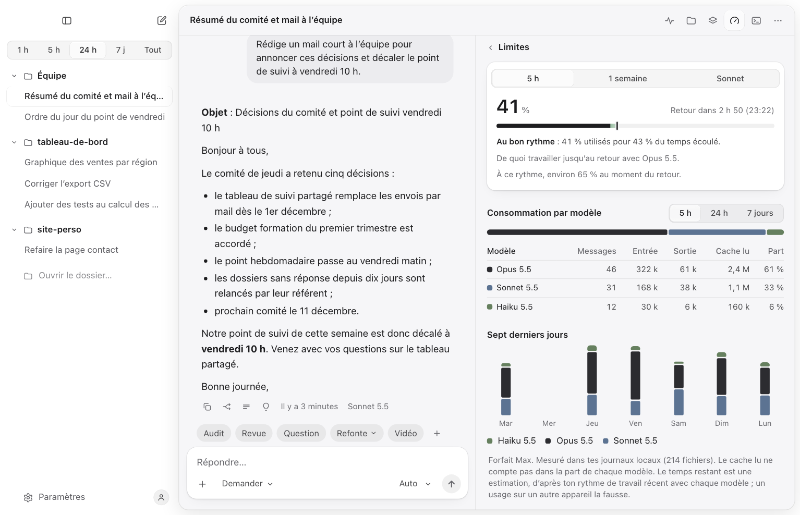

# Fil

> Mon interface personnelle pour travailler avec les IA : à chaque message, Fil choisit le modèle et la puissance qui suffisent, en ménageant les limites de mon forfait.

**Type** : app Mac · **Techno** : Electron, React, TypeScript, Claude Agent SDK · **Statut** : utilisé au quotidien · **Période** : novembre 2026

## Le problème
Sur un forfait Claude, le modèle le plus puissant partout vide la limite de 5 h bien trop tôt, et choisir à la main à chaque message est intenable. Je voulais une interface qui choisisse à ma place et qui l'explique.

## Ce que fait l'outil
- Une conversation par dossier : l'IA lit, écrit et lance des commandes, avec mon autorisation.
- À chaque message, Fil lit la demande (type, difficulté sur 10) et note chaque couple modèle et puissance : chance de réussir, moins le coût en limites. Le choix s'affiche pendant que j'écris.
- Le choix s'explique en un clic : raison, part prévue de la limite de 5 h, modèles écartés. Je peux le corriger.
- Les limites sont suivies en direct : un modèle qui ferait déborder une limite est écarté tant qu'un autre tient, sinon Fil prend le plus léger.
- Fil peut passer la main, avec un relais de la conversation, à ChatGPT ou Gemini s'ils sont connectés au Mac, à DeepSeek (payé à l'usage) ou à Qwen en local.

## En images

*Pourquoi ce modèle : difficulté, part de la limite, modèles écartés.*

*Le panneau Limites : rythme, temps restant, consommation.*

*Réglages : priorité Qualité, Équilibre ou Économie.*

Captures de l'interface réelle, avec des données fictives : aucune vraie conversation ni aucun vrai compte.

## Comment je l'ai construit
Avec Claude Code en deux semaines (52 commits) : je décris les règles, il écrit le code, je vérifie sur de vrais cas. Une relecture par Gemini, vérifiée par Claude, a montré que le classifieur obtenait 93,8 % sur des exemples écrits à la main, comme ceux de l'entraînement, mais 19 % sur 200 vrais messages (47,5 % après correction) : depuis, je mesure sur de vrais cas. Environ 15 000 lignes de TypeScript et plus de 300 tests. Son routeur sert aussi à Aiguillage.

Code privé, démo possible sur demande.
