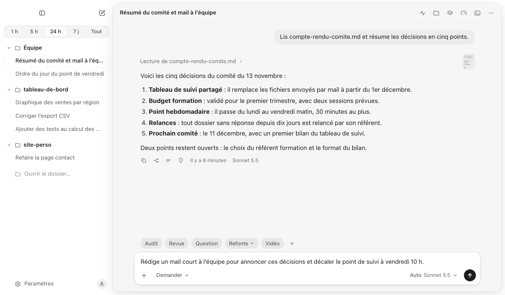
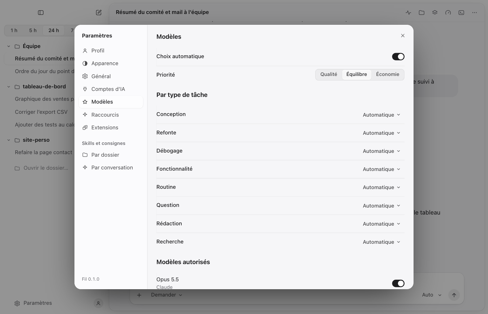

# Fil

> Mon interface personnelle pour travailler avec les IA : à chaque message, Fil choisit le modèle et la puissance qui suffisent, en ménageant les limites de mon forfait, y compris celle de 5 h.

**Type** : app Mac · **Techno** : Electron, React, TypeScript, Claude Agent SDK · **Statut** : utilisé au quotidien · **Période** : novembre 2026

## Le problème
Sur un forfait Claude, tout passe par deux compteurs : une limite sur 5 heures et une limite à la semaine. Prendre le modèle le plus puissant pour chaque message vide la fenêtre de 5 h bien avant la fin, et choisir soi-même le modèle et la puissance à chaque message est trop fastidieux pour être tenu. Je voulais une interface qui fasse ce choix à ma place, qui l'explique, et qui sache aussi se servir de ChatGPT ou de Gemini quand je les ai.

## Ce que fait l'outil
- Une conversation par dossier de travail : l'IA lit, écrit et lance des commandes dans ce dossier (le moteur de Claude Code) et, par défaut, demande l'autorisation avant d'agir.
- À chaque message, Fil lit la demande (type de tâche, difficulté de 1 à 10, travail à prévoir) et note chaque couple modèle et puissance : sa chance de réussir, moins ce qu'il mangerait de mes limites. Le choix s'affiche pendant que j'écris.
- Le choix s'explique : un clic sur le nom du modèle sous une réponse montre la raison, la part prévue de la limite de 5 h, les modèles écartés et pourquoi. Je peux corriger le type de tâche, et un refus fait monter la difficulté d'un cran au message suivant.
- Les limites sont suivies en direct : rythme par rapport au temps écoulé, temps de travail restant avec le modèle en cours, consommation par modèle sur sept jours. Ce qui déborderait d'une limite n'est pas lancé.
- Un compte Claude suffit. Si l'app ChatGPT ou l'app Gemini est connectée sur le Mac, Fil peut leur passer la main ; le moteur suivant reçoit un relais de ce qui s'est dit avant lui.
- Autour de la conversation : fichiers, terminal, navigateur intégré, boutons Audit, Revue et Vidéo, et une mise à jour automatique de l'app après un `git pull`.

## En images

*Pourquoi ce modèle : la difficulté lue, la part prévue de la limite de 5 h, les modèles écartés de peu (Opus, GPT-6, Gemini), et le type de tâche, corrigeable d'un clic.*

*Le panneau Limites : la session de 5 h au bon rythme, le temps de travail restant, la consommation par modèle.*

*Les réglages du choix automatique : priorité Qualité, Équilibre ou Économie, un modèle imposé par type de tâche si je le veux, les modèles autorisés.*

Captures de l'interface réelle, avec des données fictives : aucune vraie conversation ni aucun vrai compte.

## Comment je l'ai construit
Construit avec Claude Code en deux semaines (52 commits, du 2 au 15 novembre 2026) : je décris le besoin et les règles, Claude Code écrit le code, je vérifie chaque résultat sur de vrais cas. Le cœur est le routeur, qui lit et choisit en 0,02 ms ; sa prévision du travail est calée sur 834 vrais tours mesurés, et une note de recherche sourcée fixe ce qu'on sait, et ne sait pas, des limites des forfaits. La leçon la plus utile est venue d'une relecture du routeur par Gemini, que Claude a vérifiée point par point dans le code : le classeur de demandes affichait 93,8 % de réussite, mais sur des exemples écrits par le même auteur que ses exemples d'entraînement. Sur 200 vrais messages jamais vus, il trouvait le bon type de tâche 19 % du temps, 47,5 % après correction ; depuis, je mesure sur de vrais cas. L'ensemble fait environ 15 000 lignes de TypeScript, avec un peu plus de 300 tests unitaires et un test de bout en bout qui pilote la vraie app avec de faux moteurs. Son routeur sert aussi de cœur à un projet voisin, Aiguillage.

Code privé, démo possible sur demande.
