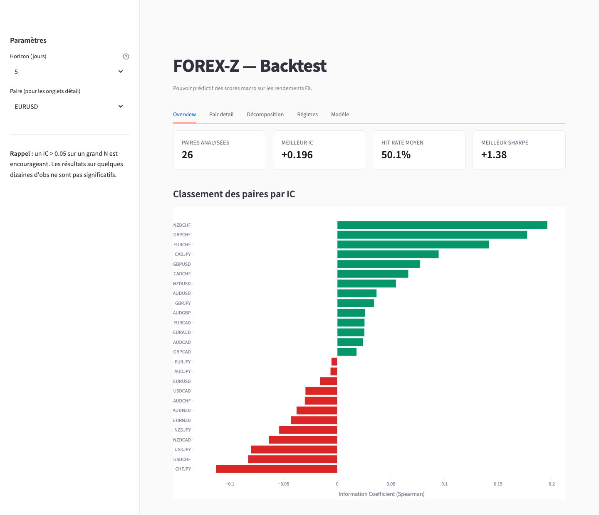
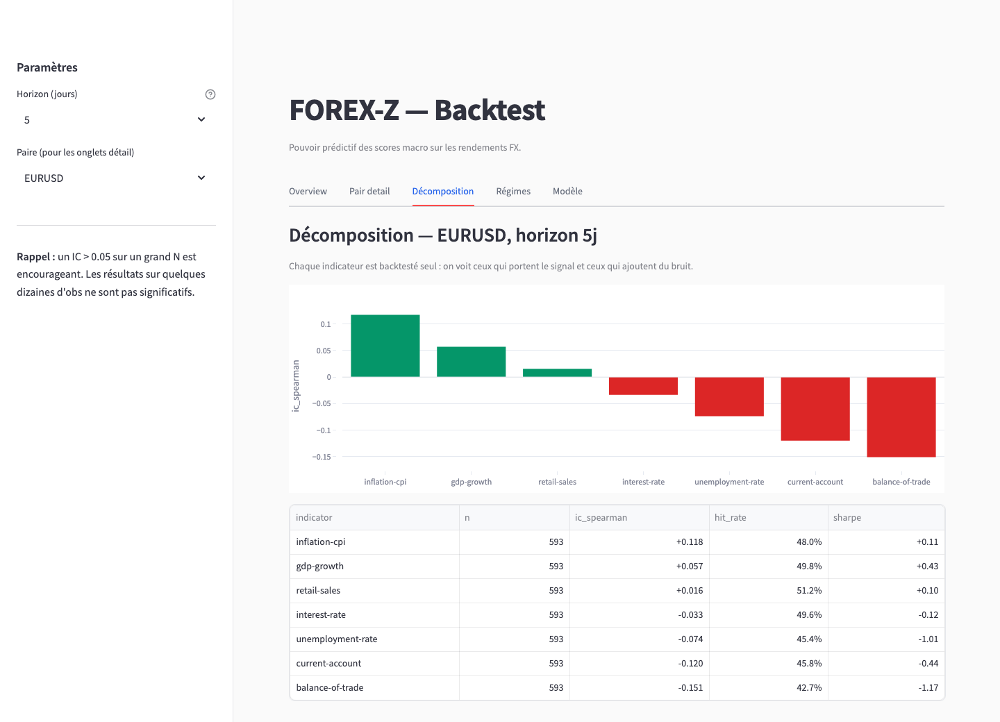
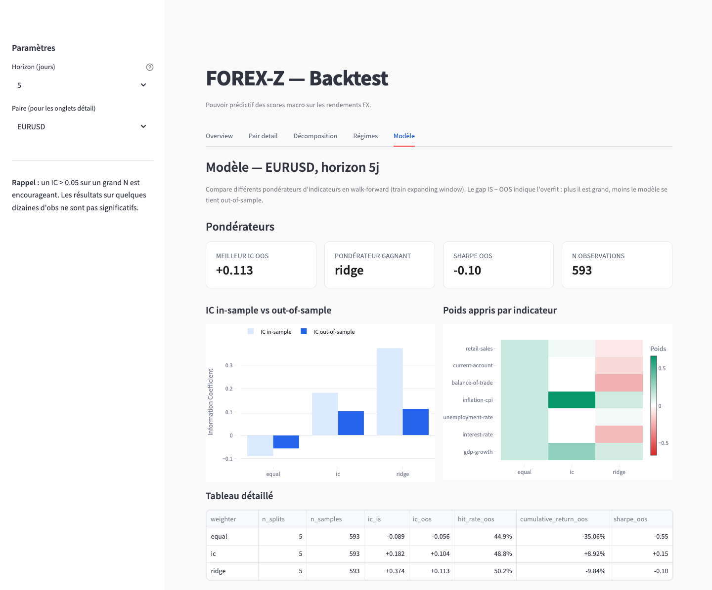

# FOREX-Z

> Un pipeline qui note chaque paire de devises à partir des surprises économiques des deux pays et du positionnement des spéculateurs, avec un tableau de bord pour vérifier si ce score annonce vraiment quelque chose.

**Type** : pipeline de données Python + tableau de bord web · **Techno** : Python, pandas, SQLite, Streamlit / Plotly · **Statut** : prototype à but pédagogique · **Période** : février – avril 2026

*Dernier calcul enregistré par le pipeline (avril 2026) : score par indicateur, composante COT et score total pour 26 paires. Tableau mis en forme pour cette fiche à partir de la base SQLite du dépôt.*

## Le problème
Sur le marché des changes, une devise réagit moins au chiffre publié qu'à l'écart avec ce qui était attendu : la « surprise ». Suivre ces surprises à la main pour 8 économies et 7 indicateurs, puis les combiner paire par paire, est fastidieux. Je voulais un outil qui le fasse seul, puis vérifier honnêtement si le score obtenu a un pouvoir prédictif.

## Ce que fait l'outil
- Suit 7 indicateurs (PIB, taux directeur, chômage, inflation, balance commerciale, compte courant, ventes au détail) pour 8 économies : zone euro, États-Unis, Royaume-Uni, Japon, Suisse, Canada, Australie, Nouvelle-Zélande. La boucle tourne toutes les heures et ne relit un indicateur que lorsqu'une nouvelle publication est attendue.
- Compare chaque chiffre au consensus (ou à la prévision) : +1 s'il est meilleur, -1 s'il est moins bon, inversé pour le chômage. Ce signe est multiplié par un facteur qui grandit avec le z-score de la surprise et l'importance de l'indicateur : une surprise rare pèse plus qu'une surprise habituelle.
- Calcule un score pour 26 paires (score de la devise de base moins celui de la devise de cotation) et y ajoute le sentiment des spéculateurs, tiré du rapport hebdomadaire COT de la CFTC.
- Garde tout l'historique dans SQLite et ne recalcule que ce qui a changé ; une erreur réseau est journalisée sans arrêter la boucle.
- Backteste le score contre les cours historiques (via yfinance) : corrélation de rang avec le rendement futur, taux de bonnes directions, Sharpe, perte maximale, indicateur par indicateur, par année et par régime de volatilité.
- Compare trois façons de pondérer les indicateurs (à parts égales, selon leur corrélation passée, régression ridge) en validation glissante, pour mesurer l'écart entre l'échantillon d'apprentissage et la suite.

## En images
Les trois écrans suivants sont le vrai tableau de bord du projet, lancé sur une base de **données synthétiques** générées pour la démonstration : les chiffres affichés ne sont pas des résultats réels. Le pipeline n'a tourné que de février à avril 2026, trop peu pour un backtest sérieux (le tableau de bord refuse de conclure sous 10 observations par paire).

*Vue d'ensemble : les 26 paires classées selon le lien entre score et rendement à 5 jours.*

*Décomposition : chaque indicateur testé seul, pour séparer ceux qui portent le signal de ceux qui ajoutent du bruit.*

*Modèle : trois pondérations comparées ; l'écart entre in-sample et out-of-sample révèle le surapprentissage.*

## Comment je l'ai construit
Construit avec Claude Code : je décris le besoin et les règles de calcul (formule de la surprise, indicateurs à inverser, poids de chaque indicateur), Claude Code écrit le code, et je vérifie les scores sur de vraies publications. Le projet compte environ 4 700 lignes de Python et 183 tests automatisés, qui tournent sans réseau grâce à une page Trading Economics et un fichier COT enregistrés. Un choix important : chaque étape est idempotente, relancer la boucle sans nouvelle donnée ne réécrit rien. Ce que j'en retiens : construire un score est facile, prouver qu'il vaut quelque chose l'est beaucoup moins, d'où la place donnée au backtest et à la validation hors échantillon.

Les premières versions publiques de ce travail : [backtrader_codex](https://github.com/Olima34/backtrader_codex) (juin 2025), un backtest avec la bibliothèque Backtrader et un indicateur technique maison, ConfluenceOscillator, qui combine RSI, CCI, MACD, ATR et bandes de Bollinger ; puis [ultimateforex](https://github.com/Olima34/ultimateforex) (juillet 2025), qui posait déjà les indicateurs par pays et les scores par paire en SQLite.

**Code source** : https://github.com/Olima34/FOREX---Z
