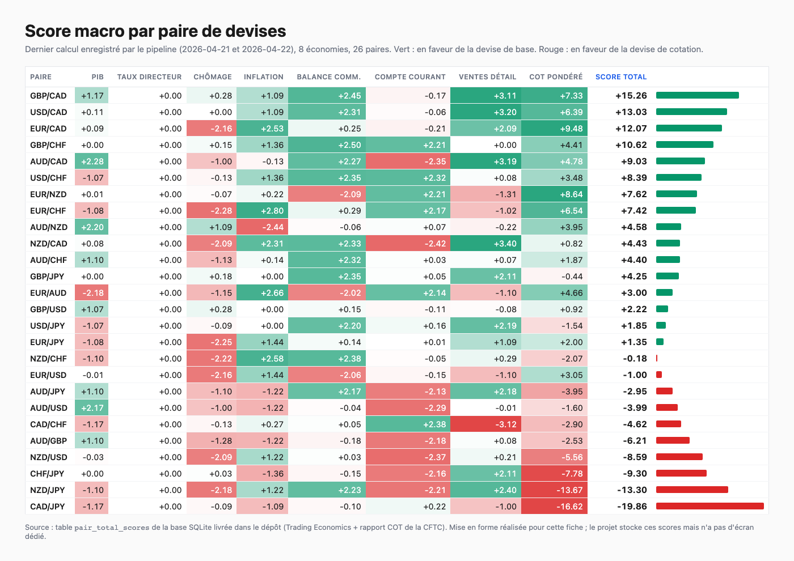

# FOREX-Z

> Un pipeline qui note chaque paire de devises selon les surprises économiques et le positionnement des spéculateurs, avec un tableau de bord pour vérifier si ce score annonce quelque chose.

**Type** : pipeline de données Python + tableau de bord web · **Techno** : Python, pandas, SQLite, Streamlit / Plotly · **Statut** : prototype à but pédagogique · **Période** : février – avril 2026

*Dernier calcul enregistré (avril 2026) pour 26 paires.*

## Le problème
Une devise réagit à l'écart avec ce qui était attendu, la « surprise ». Les suivre à la main pour 8 économies est fastidieux ; je voulais un outil qui le fasse, puis vérifier honnêtement si le score prédit quelque chose.

## Ce que fait l'outil
- Suit 7 indicateurs (PIB, inflation, chômage…) pour 8 économies.
- Compare chaque chiffre au consensus : le signe est pondéré par le z-score de la surprise, donc une surprise rare pèse plus.
- Calcule un score pour 26 paires et y ajoute le sentiment des spéculateurs (rapport COT de la CFTC).
- Backteste le score contre les cours historiques et compare trois pondérations en validation glissante.

## En images
Vrai tableau de bord sur des **données synthétiques** : ces chiffres ne sont pas des résultats réels. Le pipeline n'a tourné que trois mois, trop peu pour un backtest sérieux.

*Les 26 paires classées selon le lien score-rendement.*

*Chaque indicateur testé seul.*

*Trois pondérations comparées ; l'écart révèle le surapprentissage.*

## Comment je l'ai construit
Avec Claude Code : je décris les règles de calcul, il écrit le code, je vérifie les scores sur de vraies publications. Environ 4 700 lignes de Python et 183 tests. J'en retiens que construire un score est facile, prouver qu'il vaut quelque chose beaucoup moins.

Les premières versions publiques de ce travail : [backtrader_codex](https://github.com/Olima34/backtrader_codex) (juin 2025), un backtest avec la bibliothèque Backtrader et un indicateur technique maison, ConfluenceOscillator, qui combine RSI, CCI, MACD, ATR et bandes de Bollinger ; puis [ultimateforex](https://github.com/Olima34/ultimateforex) (juillet 2025), qui posait déjà les indicateurs par pays et les scores par paire en SQLite.

**Code source** : https://github.com/Olima34/FOREX---Z
