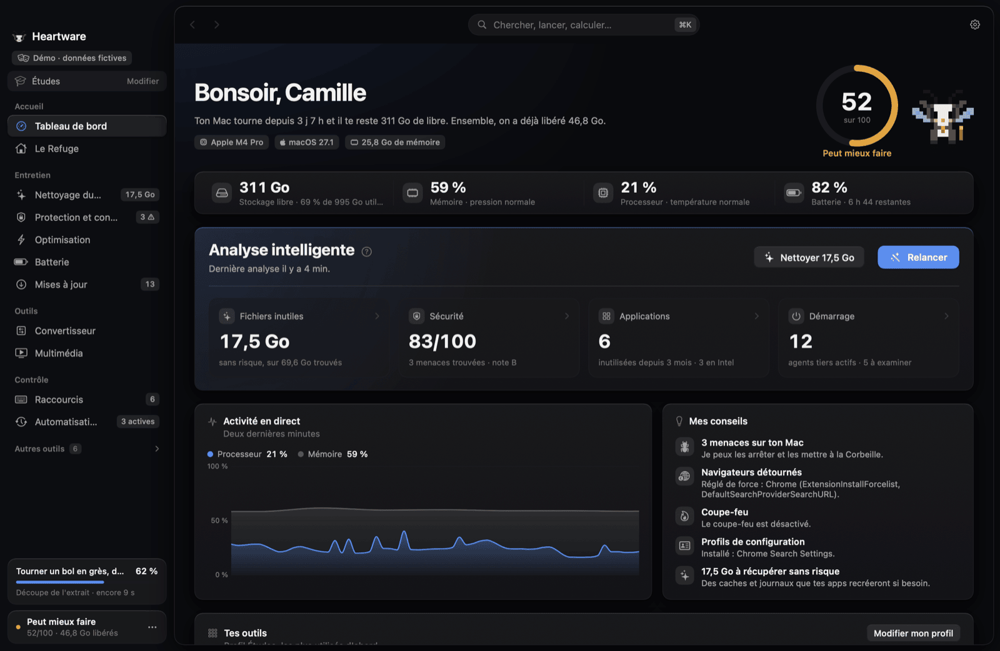
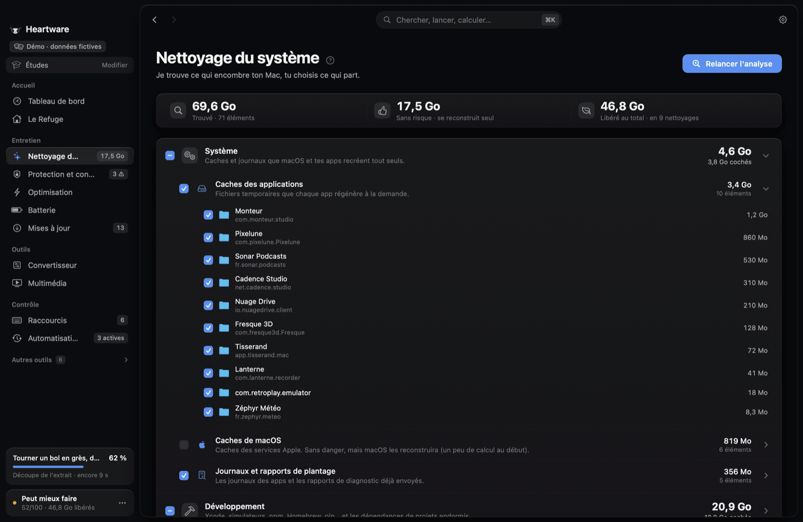
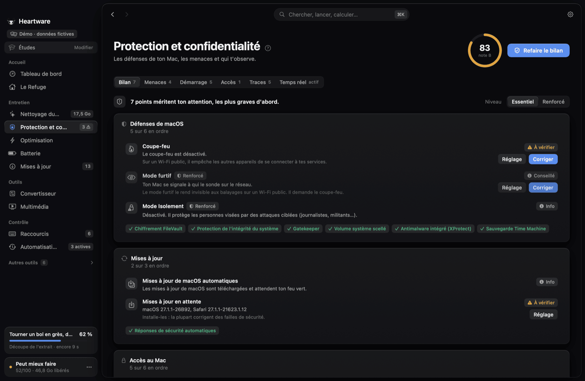
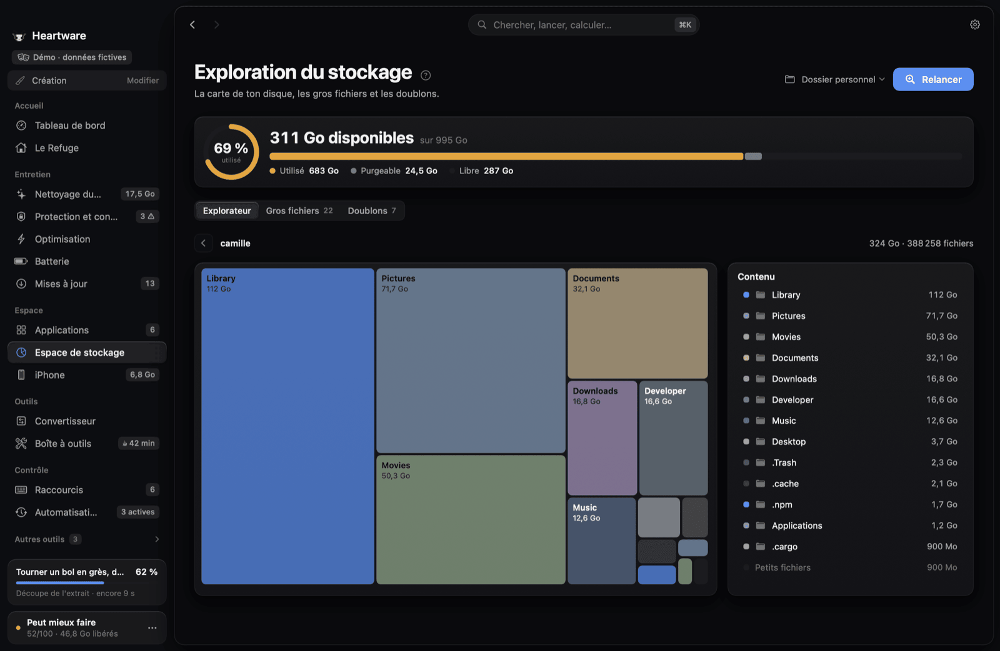

# Heartware

> Un utilitaire d'entretien natif pour macOS, gratuit : nettoyage, sécurité, applications, stockage et menu d'état réunis dans une seule app, pour tout utilisateur de Mac.

**Type** : app Mac native · **Techno** : Swift, SwiftUI, Swift Package Manager · **Statut** : en cours, versions publiées sur GitHub · **Période** : octobre 2026

## Le problème
Pour garder un Mac propre et sûr, on jongle entre plusieurs utilitaires, souvent payants, et on hésite à les laisser supprimer des fichiers sans savoir lesquels. Je voulais une seule app gratuite (« Claude, nettoie mon Mac ») qui explique ce qu'elle trouve et ne supprime rien sans accord. Le projet s'appelait d'abord Clean My Claude.

## Ce que fait l'outil
- **Tableau de bord** : une note de santé sur 100 et une « analyse intelligente » qui passe en revue fichiers inutiles, sécurité, applications et programmes au démarrage, puis classe les conseils par utilité.
- **Nettoyage** : caches, journaux, outils de développement (Xcode, npm, Homebrew…), dépendances de projets endormis, Corbeille. Tout passe par une confirmation, et les fichiers personnels partent dans la Corbeille, jamais effacés directement.
- **Sécurité** : un bilan de 40 points noté sur 100, avec correction en un clic quand c'est sûr, et un antimalware qui applique les 572 règles d'Apple (XProtect) à tout ce qui est déjà sur le disque.
- **Applications et stockage** : désinstallation complète (l'app et les fichiers qu'elle laisse), repérage des apps inutilisées ou Intel, carte du disque, gros fichiers et doublons.
- **Menu d'état et lanceur** : processeur, mémoire, disque, batterie et apps gourmandes dans la barre des menus ; `⌥ Espace` ouvre un lanceur pour les apps, les fichiers et toutes les actions de l'app.
- **Assistant Claude** : on pose une question sur son Mac en français, Claude explique et propose jusqu'à trois actions sans danger, lancées d'un clic.

## En images
| | |
|---|---|
|  |  |
| Le nettoyage : chaque catégorie détaillée, on coche ce qui part | Le bilan de sécurité noté sur 100, avec ses corrections |
|  | |
| La carte du disque, dossier par dossier | |

Toutes les captures sortent du mode démo de l'app, avec un Mac et un utilisateur inventés.

## Comment je l'ai construit
Je l'ai construit avec Claude Code : je décris le besoin et les règles, Claude Code écrit le code, je vérifie chaque résultat sur mon Mac. Les règles du projet sont écrites une fois dans un fichier que Claude Code relit à chaque session : toute suppression passe par un seul point d'entrée qui refuse ce qui sort du dossier personnel, et chaque module a ses autotests (`--selftest`), lancés à chaque compilation. Un mode démo à données fictives permet de rendre chaque écran en image sans lire le disque, ce qui a servi pour les captures. Le résultat fait environ 103 000 lignes de Swift sans aucune dépendance, et plus de 40 versions ont été publiées automatiquement par l'intégration continue ; l'app se met à jour seule. J'en retiens que, pour un outil qui supprime des fichiers, les garde-fous comptent plus que les fonctions : « un nettoyeur qui supprime trop, c'est pire que pas de nettoyeur ».

**Code source** : https://github.com/Olima34/Heartware
