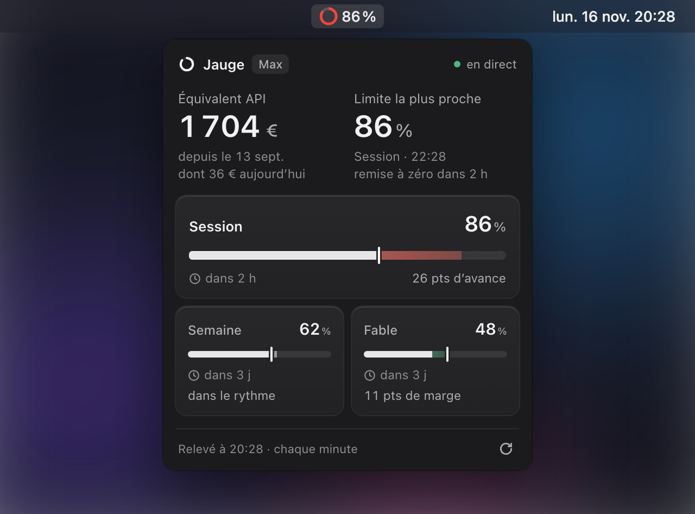
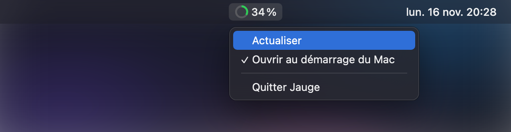

# Jauge

> Mes limites d'utilisation de Claude en direct dans la barre des menus du Mac, pour voir d'un coup d'œil si je consomme trop vite.

**Type** : app Mac (barre des menus) · **Techno** : Tauri 2, Rust, HTML/CSS/JavaScript · **Statut** : utilisée au quotidien · **Période** : novembre 2026

## Le problème
Mon abonnement Claude a deux limites, par session de 5 h et par semaine, et il fallait aller chercher l'information. Un pourcentage seul ne dit pas tout : 60 % utilisés, c'est confortable en fin de fenêtre, inquiétant au début.

## Ce que fait l'outil
- Affiche dans la barre des menus un anneau et le pourcentage de la session de 5 h ; un clic ouvre le détail, sans icône dans le Dock.
- Montre chaque limite (session, semaine, par modèle) avec son heure de remise à zéro.
- Compare l'utilisation au temps écoulé : vert s'il y a de la marge, jaune si je suis en avance, rouge à 15 points d'avance ou plus.
- Calcule l'« équivalent API » : ce qu'aurait coûté ma consommation au tarif public, converti en euros.
- Se met à jour chaque minute et au réveil du Mac.

## En images
| | |
|---|---|
|  |  |
| 86 % pour 60 % du temps : rouge | Mode clair : 7 points d'avance, jaune |

*Le clic droit sur l'anneau.*

Toutes les captures utilisent des données fictives.

## Comment je l'ai construit
Je l'ai construit avec Claude Code : je décris le besoin et les règles, Claude Code écrit le code, et je vérifie chaque comportement sur mon propre usage. La première version tournait sous Electron ; je l'ai refaite avec Tauri, un fond en Rust (environ 1 650 lignes) et un panneau en HTML : environ 90 Mo de mémoire au lieu de 195 Mo. Les calculs du rythme et du coût sont couverts par des tests en JavaScript et en Rust.

**Code source** : https://github.com/Olima34/jauge
