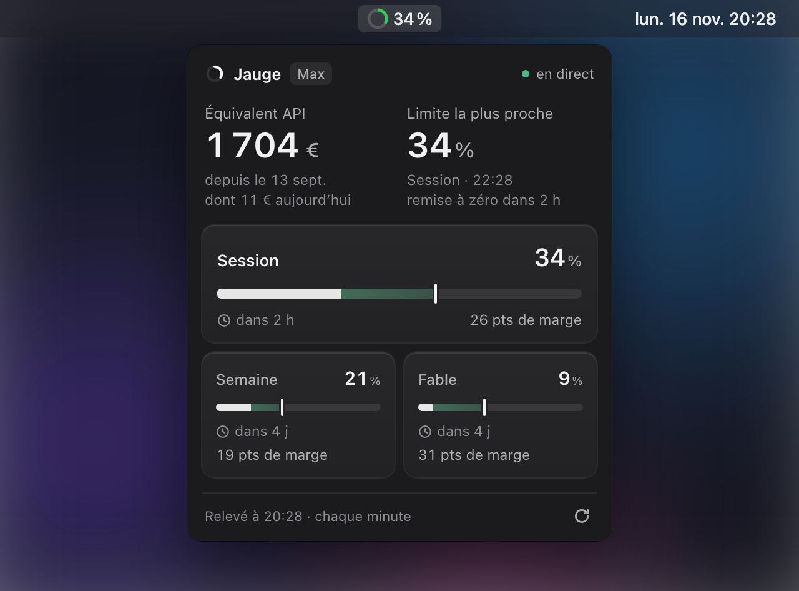
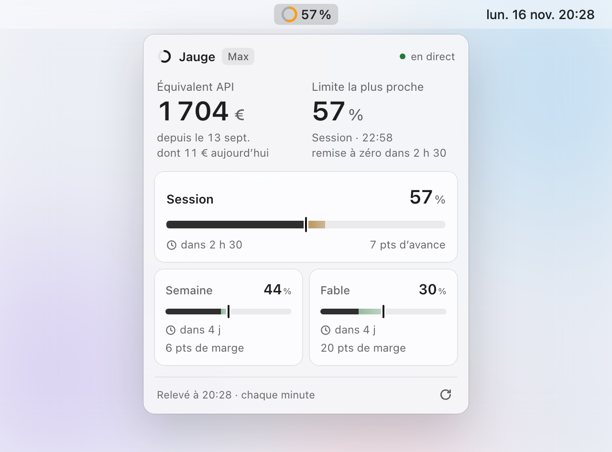

# Jauge

> Mes limites d'utilisation de Claude en direct dans la barre des menus du Mac, pour savoir d'un coup d'œil si je consomme trop vite.

**Type** : app Mac (barre des menus) · **Techno** : Tauri 2, Rust, HTML/CSS/JavaScript · **Statut** : utilisée au quotidien · **Période** : novembre 2026

## Le problème
Mon abonnement Claude a deux limites : une par session de 5 h et une par semaine. Pour savoir où j'en étais, il fallait aller chercher l'information, et un pourcentage seul ne dit pas l'essentiel : 60 % utilisés, c'est confortable si la fenêtre est presque finie, inquiétant si elle vient de commencer.

## Ce que fait l'outil
- Affiche dans la barre des menus un anneau et le pourcentage de la session de 5 h ; un clic ouvre le détail. Pas de fenêtre, pas d'icône dans le Dock.
- Montre chaque limite (session, semaine, limite par modèle) avec son heure de remise à zéro et un compte à rebours.
- Compare l'utilisation au temps écoulé dans la fenêtre : un trait marque le temps écoulé, un voile vert indique de la marge, jaune une avance, rouge 15 points d'avance ou plus. L'anneau prend la même couleur.
- Calcule l'« équivalent API » : ce qu'aurait coûté ma consommation au tarif public de l'API, depuis le premier échange trouvé dans les journaux de Claude Code, converti en euros au taux du jour de la BCE.
- Se met à jour chaque minute, dès que Claude écrit dans ses journaux (au plus toutes les 20 s) et au réveil du Mac ; espace les relevés à 5 min quand le Mac est verrouillé, et passe l'anneau en gris sans relevé réussi depuis 10 min.

## En images
| | |
|---|---|
|  |  |
| Session à 86 % pour 60 % du temps écoulé : barre et anneau en rouge | En mode clair, 7 points d'avance : voile jaune |

*Le clic droit sur l'anneau : actualiser, ouverture au démarrage du Mac, quitter.*

Toutes les captures utilisent des données fictives.

## Comment je l'ai construit
Je l'ai construit avec Claude Code : je décris le besoin et les règles (seuils de couleur, rythme des relevés, ce qui doit rester neutre), Claude Code écrit le code, et je vérifie chaque comportement sur mon propre usage. La première version tournait sous Electron ; je l'ai refaite avec Tauri, un fond en Rust (environ 1 650 lignes) et un panneau en HTML affiché par le WebKit de macOS : environ 90 Mo de mémoire au lieu de 195 Mo. Les limites viennent du programme Claude livré avec le SDK Claude Agent, interrogé comme le fait le SDK ; comme cette demande est marquée expérimentale, la version est épinglée. Pour l'équivalent API, seuls les journaux qui changent sont relus et la position de lecture est sauvegardée, ce qui évite de tout relire à chaque démarrage. Les calculs du rythme et du coût sont couverts par des tests en JavaScript et en Rust.

**Code source** : https://github.com/Olima34/jauge
