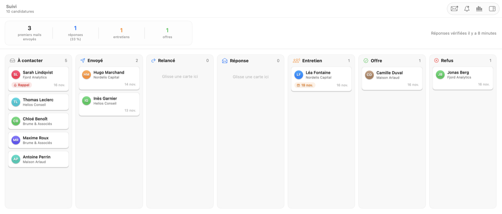
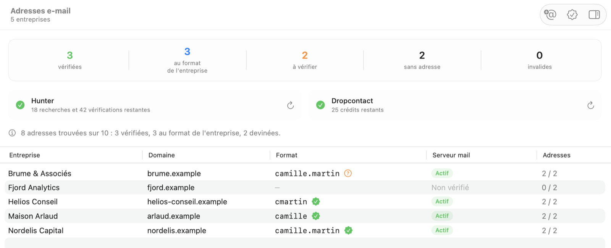
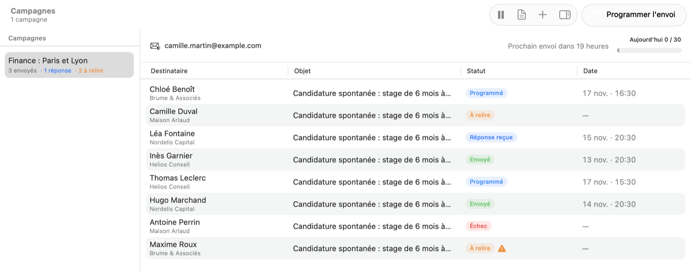
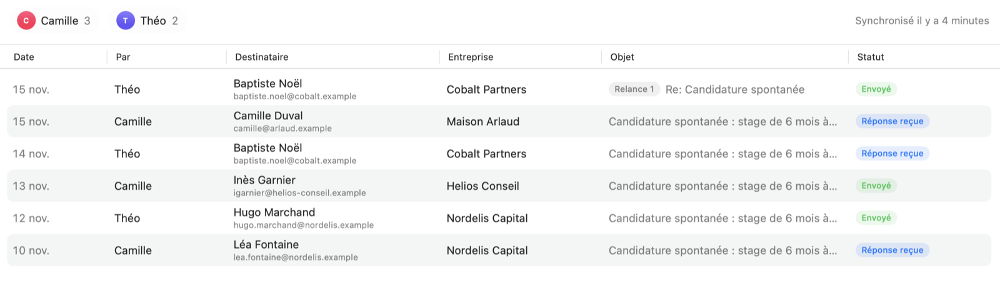

# Link Me

> Une app Mac native pour décrocher un stage : elle trouve des contacts sur LinkedIn, déduit leur adresse e-mail pro, envoie des candidatures personnalisées depuis ma propre adresse et suit chaque piste jusqu'à l'offre.

**Type** : app Mac (projet à deux) · **Techno** : Swift, SwiftUI (Liquid Glass, macOS 26), Supabase, API Claude · **Statut** : les 5 étapes du cahier des charges sont livrées (v0.1.10) · **Période** : octobre 2026

## Le problème
Chercher un stage par candidatures spontanées, c'est une suite de tâches répétitives : trouver la bonne personne sur LinkedIn, deviner son adresse e-mail, écrire un mail sur mesure, relancer, puis se souvenir de qui a répondu. Nous étions deux à chercher en même temps, avec le risque d'écrire chacun à la même personne.

## Ce que fait l'outil
- **Contacts LinkedIn** : dans une vue LinkedIn intégrée où je suis connecté moi-même, l'app relève les profils affichés, sous des plafonds quotidiens prudents, et s'arrête à la moindre vérification ou CAPTCHA. Je coche les profils à garder avant qu'ils rejoignent les contacts (doublons fusionnés).
- **Adresses e-mail** : domaine de l'entreprise, vérification qu'il reçoit du courrier, formats probables (`prenom.nom`, `pnom`…), confirmation par Hunter puis Dropcontact. Chaque adresse porte un niveau de confiance, et un format confirmé sert à tous les collègues.
- **Campagnes** : modèles par langue avec variables, une accroche proposée par Claude et toujours relue, un aperçu avant validation. L'envoi part de ma propre adresse, vers 9 h à l'heure du destinataire, sous un plafond quotidien qui monte peu à peu.
- **Relances et suivi** : relances annulées dès qu'une réponse arrive, réponses repérées dans la boîte de réception, colonnes de « À contacter » à « Offre », rappels et taux de réponse.
- **Registre commun** (Supabase) : chaque envoi y est noté. L'app prévient d'un doublon et bloque l'envoi à une personne que l'autre a contactée dans les 6 derniers mois.
- **Mises à jour automatiques** : chaque version validée par l'intégration continue est signée, publiée, puis proposée à chacun de nous deux au lancement de l'app.

## En images
| | |
|---|---|
|  |  |
| Adresses e-mail : format de chaque entreprise et niveau de confiance | Campagne : chaque mail est relu, programmé puis suivi |

Registre commun : qui a écrit à qui, et où en est la piste

Toutes les captures viennent du mode démo de l'app, avec des données inventées.

## Comment je l'ai construit
Projet mené à deux : l'app sert deux candidats qui prospectent en parallèle, et les 13 commits du dépôt viennent de mon compte. Je l'ai construite avec Claude Code : j'ai écrit le cahier des charges et les règles, Claude Code a écrit le code, et j'ai vérifié chaque étape sur de vrais cas. Comme deux sessions pouvaient travailler en même temps, un fichier de règles impose un module par dossier, une branche par sujet et des modules qui ne s'importent jamais entre eux. Deux choix de prudence : pas de sondage des serveurs mail pour vérifier une adresse (technique associée au spam), et des clés API rangées dans le trousseau de macOS, jamais dans le dépôt. Au total, environ 12 000 lignes de Swift, aucune dépendance externe et 368 vérifications automatiques, plus un mode démo qui n'écrit rien et n'appelle aucun réseau.

Code privé, démo possible sur demande.
