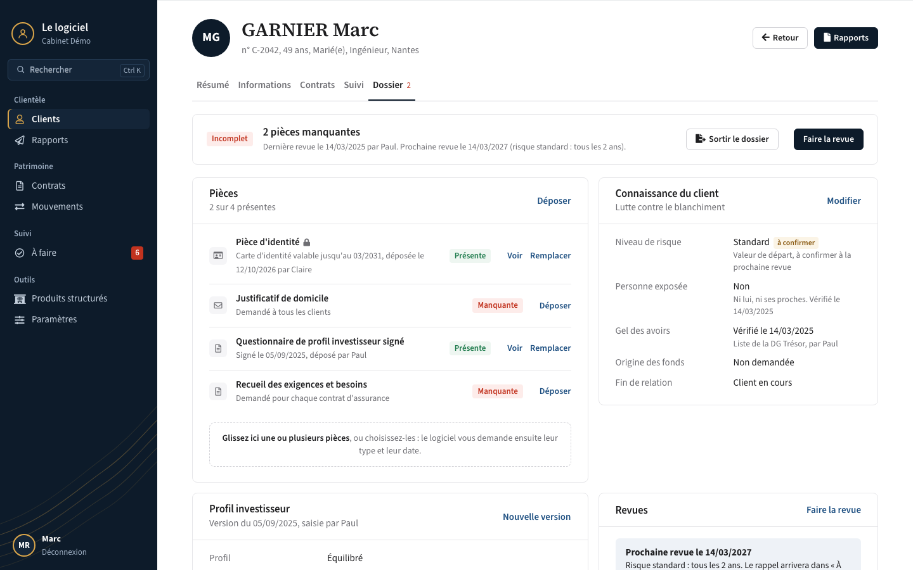

# Refonte du logiciel d'un cabinet

> Une cinquantaine de maquettes cliquables pour refondre le logiciel interne d'un cabinet de gestion de patrimoine : fiche client, tâches, rapports, dossier réglementaire.

**Type** : maquettes web (HTML) · **Techno** : HTML, CSS, JavaScript, Python · **Statut** : terminé (maquettes validées, refonte visuelle codée ensuite) · **Période** : octobre-novembre 2026

## Le problème
La fiche client était éclatée en 9 onglets et alertes et tâches vivaient dans deux menus. Surtout, rien ne suivait le dossier réglementaire : profils de risque sans date, pièces écrasées, aucun historique.

## Ce que montrent les maquettes
- **Une page d'accueil par personne** : tâches en retard et du jour, dossiers à revoir, rapports non envoyés.
- **Le dossier réglementaire du client** : pièces, connaissance du client, profil investisseur daté, prochaine revue calculée selon le risque.
- **La fiche client en 4 onglets au lieu de 9**, avec un « fil » mensuel des échanges, mouvements, rapports et tâches.
- **Relances, rapports, messagerie** : revue en retard ou rapport à envoyer arrivent dans les tâches, avec la raison.

## En images
| | |
|---|---|
|  |  |
| Le dossier réglementaire d'un client | Revues en retard |

*Le fil du client.*

Toutes les données affichées sont fictives.

## Comment je l'ai construit
Avec Claude Code : je décris l'écran et les règles du métier, il écrit la maquette, je vérifie et je tranche. Chaque série commence par un plan écrit, appuyé sur les textes (ACPR, AMF, CNIL) : j'y ai appris que, pour un contrat d'assurance vie sans opération, la connaissance du client doit être actualisée au bout de 4 ans, ou de 2 ans s'il a reçu une recommandation personnalisée. La plupart des maquettes ont ensuite été codées (une soixantaine de pull requests) et déployées sur un serveur de test, pas encore en production. Leçon : une maquette peut se tromper ; deux fois, elle présentait comme nouvelle une fonction déjà existante.

## Le lien avec Charlie
Ces écrans portent sur des tâches qu'un cabinet veut alléger : tenir le dossier à jour, relancer, préparer les rapports.

Maquettes réalisées pour un cabinet, non publiées. Démo possible sur demande.
