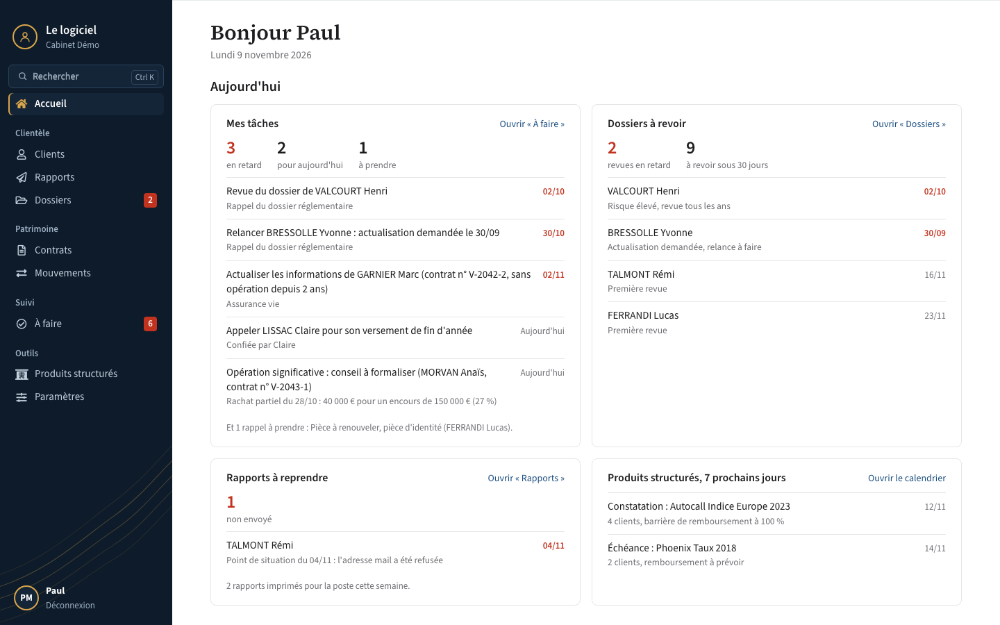
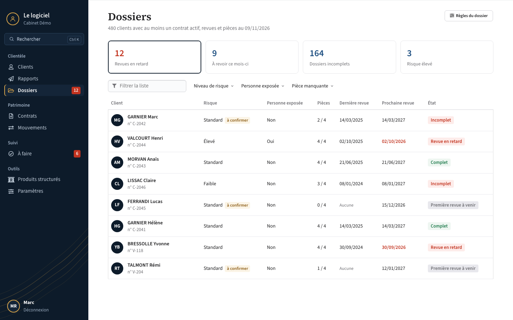
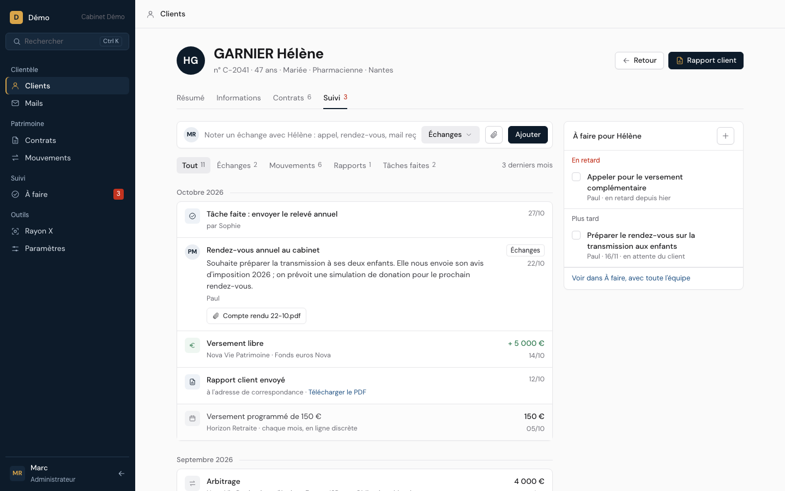

# Refonte du logiciel d'un cabinet

> Une cinquantaine de maquettes d'écrans cliquables pour refondre le logiciel interne d'un cabinet de gestion de patrimoine : fiche client, tâches, rapports et dossier réglementaire.

**Type** : maquettes web (HTML) · **Techno** : HTML, CSS, JavaScript, Python · **Statut** : terminé (maquettes validées, refonte visuelle codée ensuite) · **Période** : octobre-novembre 2026

## Le problème
Le cabinet de gestion de patrimoine où j'ai fait mon stage travaille chaque jour dans un logiciel interne. La fiche client y était éclatée en 9 onglets qui rechargeaient toute la page, alertes et tâches vivaient dans deux menus séparés, et la liste des clients ne montrait ni encours ni tâche en retard. Surtout, rien ne suivait le dossier réglementaire de chaque client : profils de risque sans date, pièces écrasées quand on les remplace, aucun historique des modifications.

## Ce que montrent les maquettes
- **Une page d'accueil par personne** : ses tâches en retard et du jour, les dossiers à revoir, les rapports qui ne sont pas partis, les échéances de produits structurés.
- **Le dossier réglementaire du client** : pièces présentes ou manquantes, connaissance du client (niveau de risque, personne exposée, gel des avoirs, origine des fonds), profil investisseur en versions datées, revue avec la prochaine date calculée selon le risque.
- **Les relances au bon moment** : une revue en retard, un contrat d'assurance vie sans opération depuis trop longtemps ou une opération significative à formaliser arrivent dans les tâches, avec la raison.
- **La fiche client en 4 onglets au lieu de 9**, avec un « fil » qui réunit, mois par mois, échanges, mouvements notables, rapports envoyés et tâches faites.
- **« À faire »** : alertes et tâches réunies dans une seule liste rangée par échéance, « Fait » en un clic.
- **Les rapports et la messagerie** : choisir un rapport, cocher les clients, vérifier, envoyer, suivre l'envoi ; entre collègues, joindre une pièce ou un client à un message, puis le transformer en tâche ou l'ajouter au fil du client.

## En images
| | |
|---|---|
|  |  |
| Le dossier réglementaire d'un client | Tous les dossiers : revues en retard, dossiers incomplets |

*Le fil du client : échanges, mouvements et rapports au même endroit, ses tâches à droite.*

Toutes les données affichées sont fictives.

## Comment je l'ai construit
Tout est fait avec Claude Code : je décris l'écran et les règles du métier, Claude Code écrit la maquette, je la vérifie et je tranche. Chaque série commence par un plan écrit : ce que le code et la base du logiciel permettent déjà, ce qui ne colle pas (par exemple, l'horizon de placement dépend du fonds, pas du contrat), les décisions à prendre et une estimation en heures. Pour le dossier réglementaire, le plan s'appuie sur les textes (ACPR, AMF, Code des assurances, CNIL) : c'est ainsi que j'ai appris qu'un contrat d'assurance vie sans opération depuis 4 ans (2 ans en cas de recommandation personnalisée) doit être actualisé. Les dernières maquettes sont fabriquées par de petits scripts Python à partir de vraies pages du logiciel, capturées sur une base fictive, pour rester fidèles à l'existant.

La plupart des maquettes de la refonte ont ensuite été codées dans le logiciel (une vingtaine de pull requests) et déployées sur le serveur de test du cabinet. Leçon retenue : une maquette peut se tromper. Deux fois, elle présentait comme nouvelle une fonction qui existait déjà ; le passage au code l'a montré.

## Le lien avec Charlie
Ces écrans portent sur les tâches qu'un cabinet veut alléger : tenir le dossier réglementaire à jour, relancer au bon moment, préparer les rapports, garder la trace des échanges dans la fiche client. Les concevoir m'a obligé à apprendre ces règles et la façon dont une petite équipe travaille vraiment.

Maquettes réalisées pour un cabinet, non publiées. Démo possible sur demande.
