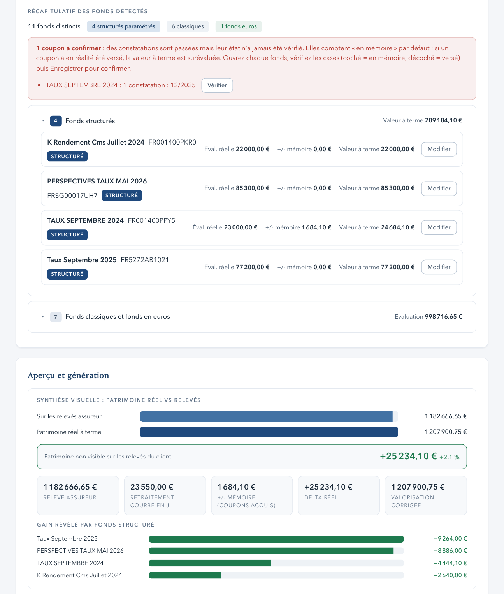

# Rayon X

> L'outil qui retraite les relevés des assureurs et produit des rapports clients corrigés, avec les fonds structurés réévalués à leur valeur réelle.

**Type** : app Mac (Electron) · **Techno** : JavaScript, Electron, ExcelJS, jsPDF · **Statut** : utilisé au quotidien · **Période** : juin à novembre 2026

## Le problème
Les relevés des assureurs valorisent les fonds structurés à leur cours du jour : une moins-value temporaire (la « courbe en J »), sans les coupons mis en mémoire. Le client voit un patrimoine plus bas que ce qu'il touchera à l'échéance ; le cabinet où j'ai fait mon stage avait besoin de montrer les deux lectures, client par client. Aujourd'hui, le gérant utilise Rayon X tous les jours : plus de 800 rapports produits.

## Ce que fait l'outil
- **Lit les relevés des assureurs** (exports Excel) : un rapport par client, et par foyer un rapport pour le couple et un par conjoint.
- **Réévalue les fonds structurés** : capital garanti à l'échéance, coupons en mémoire reconstitués, écart avec la valorisation de l'assureur.
- **Produit les rapports clients** en PDF et en Excel, avec une page qui explique « relevé assureur » et « relevé retraité ».
- **Contrôle puis envoie par email** : coupons non confirmés, documents manquants, aperçu et envoi de test.

## En images
Captures sur un jeu d'essai entièrement fictif.

*Le rapport généré.*

*Relevé de l'assureur à gauche, lecture retraitée à droite.*

*L'analyse d'un relevé.*

## Comment je l'ai construit
Avec Claude Code : je décris le besoin et les règles de calcul, il écrit le code, je vérifie chaque résultat sur de vrais relevés avant qu'un rapport parte. Le cœur : environ 17 000 lignes de JavaScript sans framework. Tout tourne sur le poste, données chiffrées ; 969 contrôles automatisés protègent les calculs. J'en retiens qu'une règle financière n'est fiable qu'écrite, testée et rappelée au client : chaque rapport précise que ces valeurs supposent de garder les supports jusqu'à l'échéance.

Code privé (outil d'un cabinet), démo possible sur demande.
