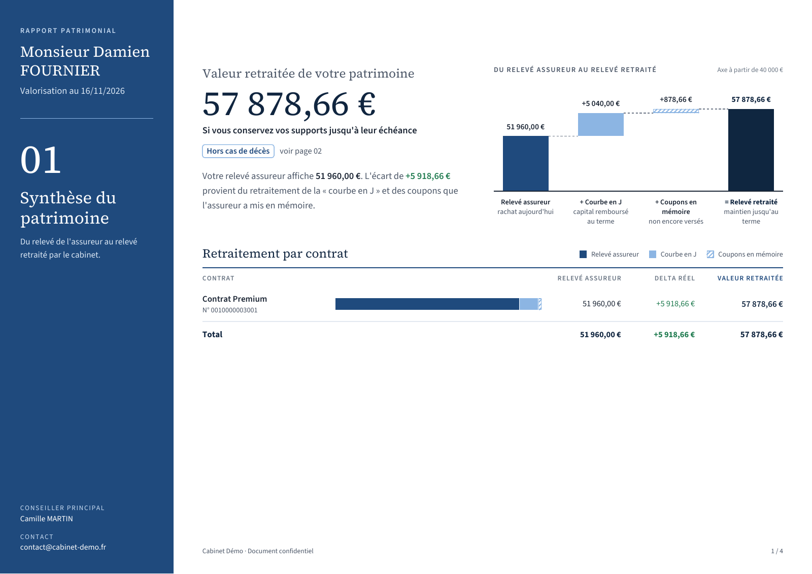
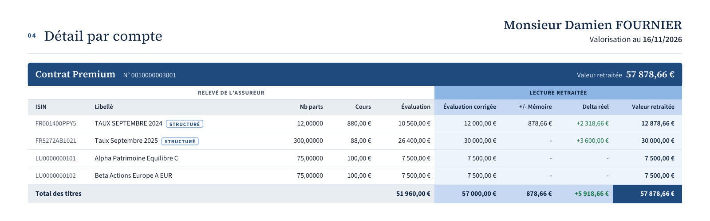

# Rayon X

> L'outil qui retraite les relevés des assureurs et produit des rapports clients corrigés, en réévaluant les fonds structurés à leur valeur réelle, pour un cabinet de gestion de patrimoine.

**Type** : app Mac (Electron) · **Techno** : JavaScript, Electron, ExcelJS, jsPDF · **Statut** : utilisé au quotidien · **Période** : juin à novembre 2026

## Le problème
Les relevés des assureurs valorisent les fonds structurés à leur cours du jour. Pendant la vie du produit, ce cours affiche souvent une moins-value temporaire (la « courbe en J ») et ne compte pas les coupons mis en mémoire : le client voit un patrimoine plus bas que ce qu'il touchera s'il garde ses supports jusqu'à l'échéance. Le cabinet de gestion de patrimoine où j'ai fait mon stage avait besoin de montrer les deux lectures, client par client. Aujourd'hui, le gérant du cabinet utilise Rayon X tous les jours : plus de 800 rapports produits.

## Ce que fait l'outil
- **Lit les relevés des assureurs** (exports Excel « états de comptes ») : un export groupé donne un rapport par client ; un foyer donne un rapport pour le couple et un par conjoint, reconnu quand les totaux concordent au centime près.
- **Réévalue les fonds structurés** : capital garanti à l'échéance (parts × valeur nominale), coupons en mémoire reconstitués constatation par constatation avec l'érosion des frais, et écart avec la valorisation de l'assureur.
- **Produit les rapports clients** en PDF et en Excel : synthèse du patrimoine, page qui explique « relevé assureur » et « relevé retraité », détail par compte, lettre d'accompagnement en option.
- **Contrôle avant de générer** : coupons jamais confirmés, documents manquants, clients sans email. Un script de validation fait passer chaque client par toute la chaîne et relit le fichier produit cellule par cellule.
- **Suit les clients et les produits** : base clients locale, constatations et échéances à venir sur le tableau de bord, ajout d'un fonds structuré en lisant son document d'informations clés (PDF).
- **Envoie les rapports par email** en campagne : aperçu fidèle, envoi de test, confirmation avant l'envoi groupé, historique des envois.

## En images
Toutes les captures sont faites sur un jeu d'essai entièrement fictif (noms, contrats et montants inventés).

*Le rapport généré : du relevé de l'assureur à la valeur retraitée, avec la part de la courbe en J et celle des coupons en mémoire.*

*Chaque fonds structuré réévalué : relevé de l'assureur à gauche, lecture retraitée à droite (valeur corrigée, coupons en mémoire, écart).*

*L'analyse d'un relevé : fonds structurés détectés, coupon à confirmer avant génération, gain révélé par fonds.*

## Comment je l'ai construit
Je l'ai construit avec Claude Code : je décris le besoin et les règles de calcul, Claude Code écrit le code, et je vérifie chaque résultat sur de vrais relevés avant qu'un rapport parte chez un client. Partie d'une page web, l'application est devenue une vraie app Mac (Electron) ; le cœur, environ 17 000 lignes de JavaScript sans framework, est resté commun aux deux. Tout tourne sur le poste, rien n'est envoyé à un tiers, et les données des clients sont chiffrées sur le disque (AES-256-GCM, clé dans le trousseau du Mac). Pour développer sans toucher aux données du cabinet, un générateur fabrique un faux export qui couvre tous les cas difficiles, et 969 contrôles automatisés protègent le parseur, les calculs et l'envoi. J'en retiens qu'une règle financière n'est fiable qu'écrite noir sur blanc, testée et rappelée au client : chaque rapport précise que ces valeurs supposent de garder les supports jusqu'à l'échéance.

Code privé (outil d'un cabinet), démo possible sur demande.
