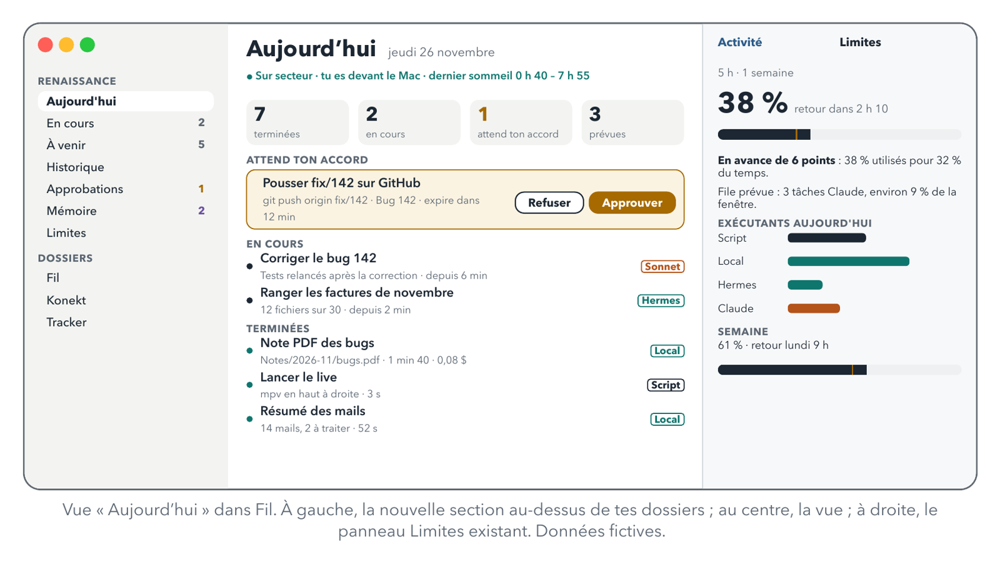
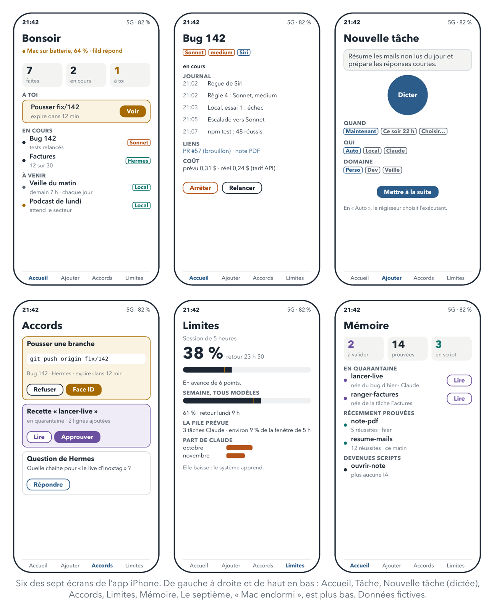

# Renaissance

> Mon assistant IA personnel sur Mac : un modèle local en première ligne, Claude en renfort, pilotable depuis l'iPhone à la voix ou en texte.

**Type** : infrastructure personnelle sur Mac (dossier de conception + scripts) · **Techno** : Ollama (Qwen en local), Claude Code, Python et shell, launchd · **Statut** : en cours (conception terminée, installation commencée) · **Période** : novembre 2026 (en cours)

## Le problème
Je voulais dire à mon iPhone « corrige les derniers bugs et fais-m'en une note PDF », et que mon Mac s'en charge sans payer chaque requête : Claude n'intervient que si le local ne suffit pas.

## Ce que fait l'outil
**En place aujourd'hui** (depuis le 13 novembre 2026) :
- **Un moteur local** : Ollama avec Qwen3.6 35B, mesuré à 78 tokens/s ; choix encore en essai.
- **Une table de routage** : 100 types de demandes, chacun avec un exécutant et un feu : vert (passe seul), orange (mon accord), rouge (jamais automatisé).
- **Un journal et ses analyses** : des scripts mesurent la part de Claude et proposent d'ajuster le routage ; je relis avant d'accepter.

**Prévu** (décembre 2026 à février 2027) :
- Le pilotage depuis l'iPhone (app SwiftUI, Siri, iMessage), avec approbation par Face ID des actions risquées.
- Fil (mon app Electron) comme tableau de bord.
- Un tri appris sur mon propre journal.

## En images

*Scripts réels, journal fictif.*

| | |
|---|---|
|  |  |
| Maquette : vue « Aujourd'hui » | Maquettes de l'app iPhone, pas codée |

Maquettes, données fictives.

## Comment je l'ai construit
Je l'ai construit avec Claude Code, en deux temps. D'abord la conception : des agents ont rédigé en parallèle 15 documents (environ 420 pages). Puis l'avis d'un ami ingénieur IA m'a fait tout réviser : un seul modèle local, tout journaliser dès le premier jour, une alarme contre l'injection de prompt. Depuis le 13 novembre, j'installe brique par brique, chaque étape finissant par un test. J'en retiens qu'un agent fiable dépend moins du modèle que des outils et de la mesure.

Code privé, démo possible sur demande.
