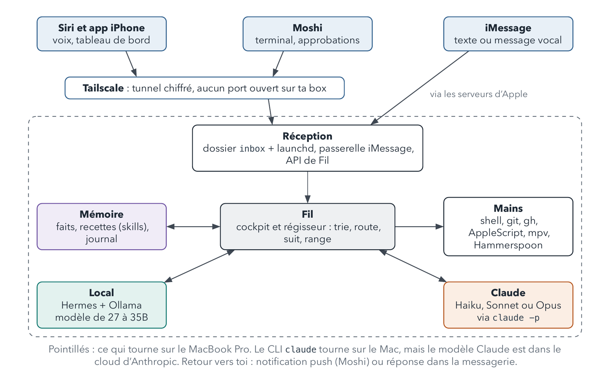
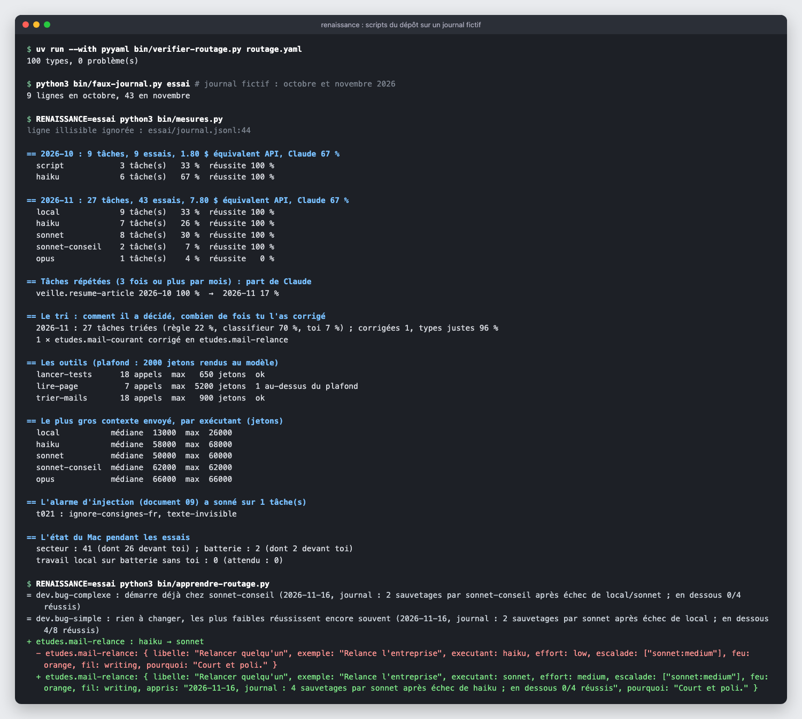

# Renaissance

> Mon assistant IA personnel sur Mac : un modèle qui tourne en local en première ligne, Claude en renfort, le tout pilotable depuis l'iPhone, à la voix ou en texte.

**Type** : infrastructure personnelle sur Mac (dossier de conception + scripts) · **Techno** : Ollama (Qwen en local), Claude Code, Python et shell, launchd · **Statut** : en cours (conception terminée, installation commencée) · **Période** : novembre 2026 (en cours)

## Le problème
Je voulais pouvoir dire à mon iPhone, en sortant : « reprends les derniers bugs trouvés, corrige-les et fais-m'en une note PDF », et que mon Mac s'en charge seul. Sans payer chaque requête : le travail courant doit tourner gratuitement sur le Mac, et Claude (mon abonnement Max) ne doit intervenir que quand le local ne suffit pas. Difficulté en plus : ce Mac est mon portable de tous les jours, pas un serveur. Il faut donc gérer la batterie, la veille et le fait que je travaille dessus en même temps.

## Ce que fait l'outil
**En place aujourd'hui** (dépôt Git sur le Mac, depuis le 13 novembre 2026) :
- **Un moteur local** : Ollama tourne en service macOS, avec une version figée. Le modèle Qwen3.6 35B (un MoE dont 3 milliards de paramètres seulement travaillent à chaque mot) a été installé et mesuré : 100 % sur le GPU, 64 000 tokens de contexte, 78 tokens/s. Le choix définitif du modèle est encore en essai.
- **Une table de routage** (`routage.yaml`) : 100 types de demandes en 5 domaines. Chaque type a son exécutant (script, modèle local, Haiku, Sonnet, Opus ou moi), son effort, sa suite en cas d'échec et un feu : vert (passe seul), orange (attend mon accord), rouge (jamais automatisé). Un script la valide avant usage.
- **Un journal et ses analyses** : le format du journal est fixé, et des scripts le lisent pour dire qui a fini quelle tâche, quelle part revient à Claude chaque mois, quels outils renvoient trop de texte au modèle et où l'alarme d'injection a sonné.
- **Un routage qui apprend** : quand un modèle plus fort rattrape plusieurs fois le même type de tâche, un script propose de le faire démarrer plus haut. Je relis le diff Git avant d'accepter.

**Prévu** (feuille de route, de décembre 2026 à février 2027) :
- Le pilotage depuis l'iPhone : app SwiftUI, raccourci Siri, iMessage et terminal, via Tailscale, avec un écran « Mac endormi depuis… » plutôt qu'une erreur.
- Fil (mon app Electron qui pilote déjà Claude Code) comme régisseur et tableau de bord, Hermes Agent comme agent local, et une approbation par Face ID pour toute action risquée (envoi, suppression, `git push`).
- En février 2027, un tri appris sur mon propre journal à la place des règles écrites à la main.

## En images

*Exécution réelle des scripts du dépôt, sur un journal fictif : validation des 100 types de routage, bilan du mois, puis proposition de confier les relances de mails à Sonnet plutôt qu'à Haiku.*

| | |
|---|---|
|  |  |
| Maquette : la vue « Aujourd'hui » à ajouter dans Fil | Maquettes de l'app iPhone, pas encore codée |

Les deux maquettes viennent du cahier des charges, avec des données fictives.

## Comment je l'ai construit
Je l'ai construit avec Claude Code, en deux temps. D'abord la conception : j'ai fixé les décisions (machine, abonnement, usages), puis plusieurs agents Claude Code ont rédigé en parallèle 15 documents (environ 420 pages), chacun avec ses sources datées, ses étapes d'installation et des scripts testés avec de faux programmes. Le 6 novembre, l'avis d'un ami ingénieur IA m'a fait tout réviser : un seul modèle local, tout journaliser dès le premier jour, des outils qui rendent au modèle un petit résumé plafonné à environ 2 000 tokens, et une alarme contre l'injection de prompt dans les mails lus (31 cas de test, dont des faux positifs). Depuis le 13 novembre, j'installe brique par brique en suivant la feuille de route, et chaque étape se termine par un test. Ce que j'en retiens : un agent fiable dépend moins du modèle que des outils qu'on lui donne, de ce qu'ils lui renvoient et de ce qu'on mesure.

Code privé, démo possible sur demande.
