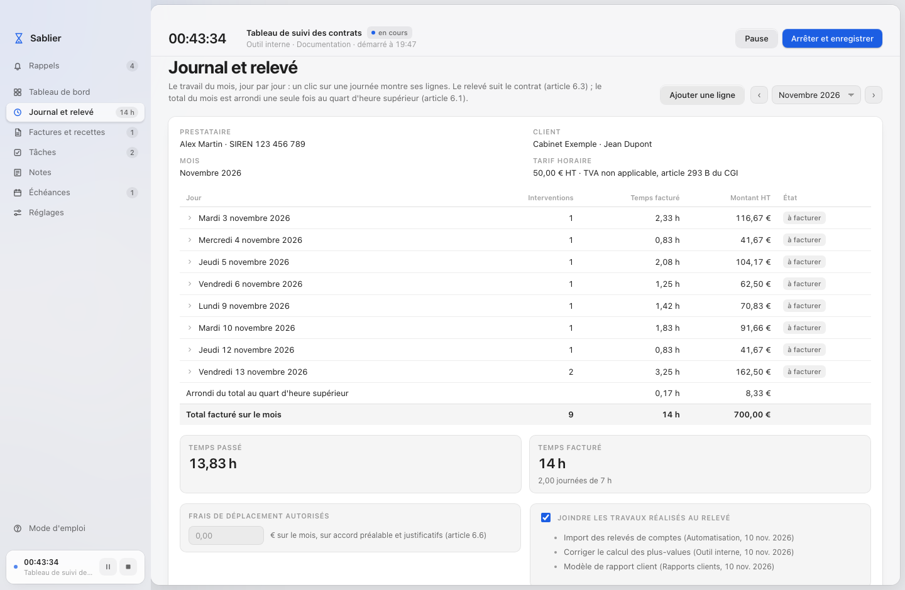

# Sablier

> Une app Mac pour suivre ma mission d'indépendant : temps passé, relevé d'activité, facture, tâches et échéances administratives.

**Type** : app macOS · **Techno** : HTML/CSS/JavaScript sans framework, Rust (Tauri 2), fichiers JSON · **Statut** : utilisé au quotidien · **Période** : septembre à novembre 2026

## Le problème
Je travaille en micro-entreprise, payé à l'heure : chaque mois, il faut un relevé exact, une facture conforme au contrat et aux mentions obligatoires, et aucune démarche oubliée (ACRE, CFE, URSSAF). Je voulais un outil qui applique ces règles et me prévienne à temps.

## Ce que fait l'outil
- **Suivi du temps** : un chrono et un journal où chaque ligne porte un axe de la mission, un libellé et une durée.
- **Relevé et facture en PDF** : générés et classés d'office, mentions légales ; une facture émise fige ses lignes.
- **Recettes** : livre des recettes et part à garder pour l'URSSAF.
- **Tâches et échéances** : tableau de tâches, calendrier administratif, notifications macOS.
- **Données sûres** : fichiers JSON lisibles, copie datée chaque jour.

## En images

*Le relevé du mois : le total est arrondi une seule fois au quart d'heure supérieur.*

*La facture générée depuis le relevé.*

*Le calendrier de la micro-entreprise.*

Les captures sont faites avec un jeu de données fictif (client et tarif inventés).

## Comment je l'ai construit
Je l'ai construit avec Claude Code : je décris le besoin et les règles de calcul, il écrit le code, je vérifie chaque relevé et chaque facture sur mes vrais mois. Une vérification a changé une règle : arrondir chaque intervention au quart d'heure faisait payer près de deux heures de trop par mois ; désormais seul le total est arrondi. Le fond, d'abord sous Electron, est passé en Rust avec Tauri : l'app est passée de 280 Mo à 12 Mo sans changer d'interface, et 57 tests couvrent le moteur de calcul. J'en retiens qu'une facture ne doit plus bouger une fois émise, et qu'il faut le prévoir dès le modèle de données.

**Code source** : https://github.com/Olima34/sablier
