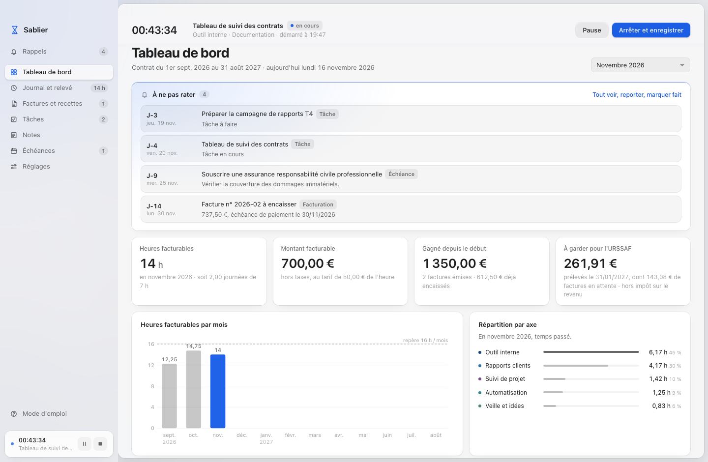
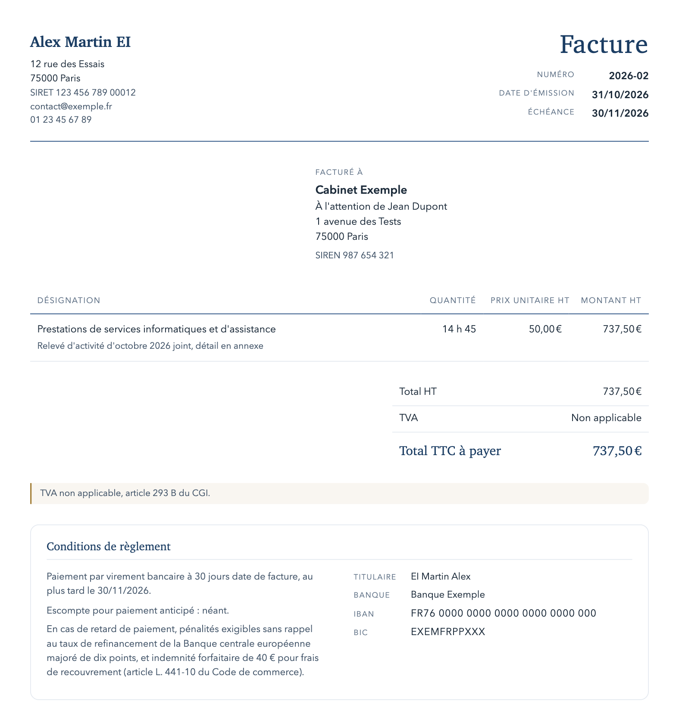
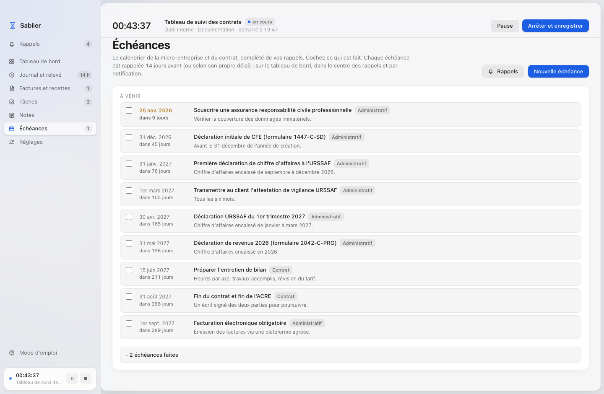

# Sablier

> Une app Mac pour suivre ma mission d'indépendant auprès d'un cabinet de gestion de patrimoine : temps passé, relevé d'activité, facture, tâches et échéances administratives.

**Type** : app macOS · **Techno** : HTML/CSS/JavaScript sans framework, Rust (Tauri 2), fichiers JSON · **Statut** : utilisé au quotidien · **Période** : septembre à novembre 2026

## Le problème
Je travaille en micro-entreprise pour un cabinet de gestion de patrimoine, payé à l'heure. Chaque mois, il faut un relevé d'activité exact, une facture conforme au contrat et aux mentions obligatoires, et ne rater aucune démarche (ACRE, CFE, déclarations URSSAF). Je voulais un seul outil qui applique ces règles sans erreur et me prévienne à temps.

## Ce que fait l'outil
- **Suivi du temps** : un chrono (barre latérale, bandeau ou carte de tâche) et un journal où chaque ligne porte un axe de la mission, un libellé et une durée.
- **Relevé et facture en PDF** : le relevé du mois et sa facture sont générés et classés d'office ; numérotation continue par année, franchise de TVA, pénalités de retard, coordonnées bancaires. Une facture émise fige ses lignes.
- **Factures et recettes** : livre des recettes, part à garder pour l'URSSAF (taux ACRE puis taux plein), date du prochain prélèvement, revenu imposable estimé après l'abattement de 34 %.
- **Tâches et notes** : tableau À faire / En cours / Fait, priorité qui monte quand l'échéance approche, notes en pages et sous-pages.
- **Échéances et rappels** : le calendrier administratif de la micro-entreprise, avec notifications macOS et pastille du Dock.
- **Données sûres** : fichiers JSON lisibles, copie datée chaque jour (30 conservées), écriture retentée si le disque la refuse.

## En images

*Le travail du mois jour par jour : le total est arrondi une seule fois au quart d'heure supérieur, sur sa propre ligne.*

*La facture générée depuis le relevé (une annexe détaille ensuite les interventions par axe).*

*Le calendrier de la micro-entreprise : CFE, déclarations URSSAF, attestation de vigilance, facturation électronique.*

Les captures sont faites avec un jeu de données fictif (client « Cabinet Exemple », tarif inventé).

## Comment je l'ai construit
Je l'ai construit avec Claude Code : je décris le besoin et les règles de calcul, Claude Code écrit le code, je vérifie chaque relevé et chaque facture sur mes vrais mois de travail. Une vérification a changé une règle : arrondir chaque intervention au quart d'heure faisait payer près de deux heures de trop par mois ; désormais seul le total est arrondi, une fois. L'interface est en HTML/CSS/JavaScript sans framework (environ 6 900 lignes) ; le fond, d'abord sous Electron, est passé en Rust avec Tauri (environ 2 000 lignes) : l'app est passée de 280 Mo à 12 Mo sans changer d'interface ni de fichiers. 57 tests couvrent le moteur de calcul, 18 le fond Rust, et un auto-test rejoue les cas limites (chrono qui passe minuit, intervention facturée en partie, report sur un autre mois) sur un dossier jetable, jamais sur les vraies données. J'en retiens qu'une facture est un document qui ne doit plus bouger une fois émise, et qu'il faut le prévoir dès le modèle de données.

**Code source** : https://github.com/Olima34/sablier
