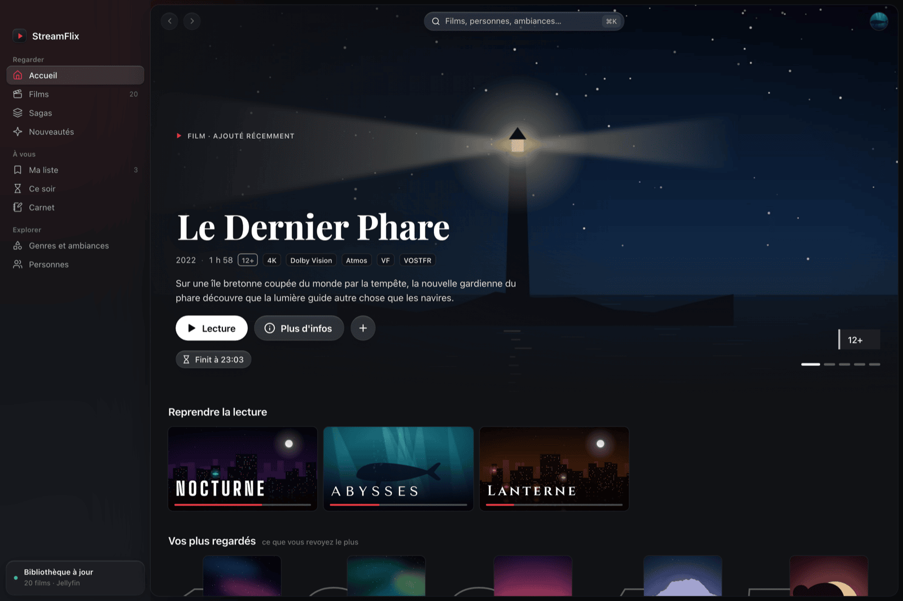
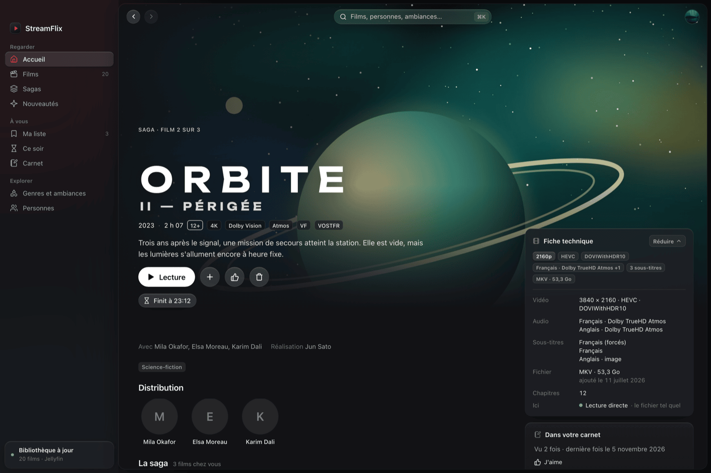
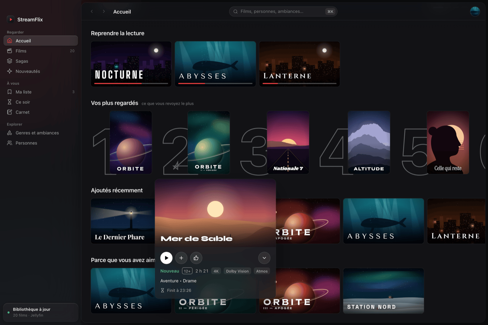
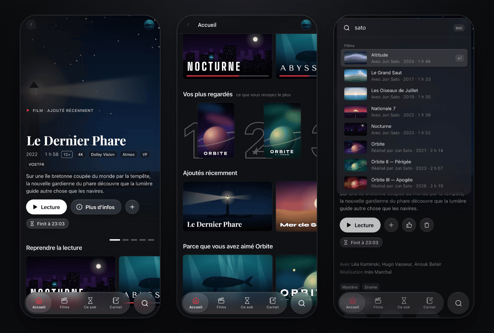

# StreamFlix

> Mon Netflix personnel : une app pour Mac, Windows et iPhone qui présente et lit ma propre vidéothèque de films, posée sur un serveur Jellyfin.

**Type** : app Mac et Windows, web app iPhone et iPad · **Techno** : React, TypeScript, Tauri, Jellyfin · **Statut** : terminé, utilisé chez moi · **Période** : novembre 2026

## Le problème
Mes films sont rangés sur un disque. Jellyfin, un serveur gratuit, sait très bien les classer, retrouver leurs fiches et les diffuser, mais son interface n'a ni l'évidence ni la mise en scène de Netflix. Je voulais ce confort pour ma propre vidéothèque, sur le Mac comme sur l'iPhone, avec deux choses que Netflix ne fait pas : dire à quelle heure le film finira, et garder la trace de ce que j'ai vu.

## Ce que fait l'outil
- **Un accueil à la Netflix** : jusqu'à cinq films à la une en fondu, puis des rangées qui disent pourquoi elles sont là (reprendre la lecture, Top 10 des plus regardés, ajoutés récemment, « parce que vous avez aimé… », par genre). Au survol, la carte s'agrandit et fait défiler des vignettes du film.
- **Une app qui connaît l'heure** : chaque film affiche « Finit à 23:12 ». L'écran *Ce soir* propose les films qui tiennent avant l'heure choisie, par humeur, avec un bouton « Surprends-moi ».
- **Fiche et lecteur** : distribution, saga, titres similaires, fiche technique (4K, HDR, pistes audio et sous-titres). Le lecteur reprend là où on s'était arrêté, gère chapitres, pistes et raccourcis clavier, et ne demande une conversion à Jellyfin que si l'appareil ne sait pas lire le fichier tel quel.
- **Une recherche ⌘K** : titres, personnes, genres, années et résumés, avec une faute de frappe tolérée.
- **Le Carnet** : chaque film vu jusqu'au générique s'y inscrit, avec mon avis et un mot. Il est rangé dans Jellyfin, donc identique sur le Mac et sur l'iPhone.
- **Sur chaque écran** : app Mac, installateur Windows, et sur iPhone ou iPad une web app plein écran servie par le Mac sur le réseau local. Le mode clair suit celui du Mac.

## En images
| | |
|---|---|
|  |  |
| La fiche d'un film de saga : heure de fin, fiche technique dépliée, carnet. | Les rangées : le Top 10 des plus regardés et la carte agrandie au survol. |

*Sur iPhone : l'accueil, les rangées et la recherche, avec la barre d'onglets en verre.*

Captures de la vraie interface, avec un catalogue fictif (titres, résumés, personnes et visuels inventés pour les maquettes du projet) et un serveur Jellyfin simulé.

## Comment je l'ai construit
Construit avec Claude Code : je décris le besoin et les règles, Claude Code écrit le code, je vérifie chaque résultat sur de vrais cas. Avant la première ligne de code, un plan de 31 pages fixait la vision, la direction artistique, 14 maquettes et une feuille de route par étapes, toutes livrées depuis. Le choix principal : ne rien refaire de ce que Jellyfin fait déjà (catalogue, fiches, reprise, conversion vidéo) et ne construire que l'interface, avec une seule base React pour le Mac (fenêtre Tauri), Windows et l'iPhone, qui parle à Jellyfin par une dizaine d'appels directs. Même le Carnet n'a pas de serveur à lui : il est stocké dans les préférences du profil Jellyfin. Le design, « Graphite », est celui de mes apps Fil et Sablier : l'interface reste neutre, la couleur vient des films. L'ensemble fait un peu plus de 3 000 lignes de TypeScript, avec 28 tests automatiques sur la logique (durées, badges, rangées, recherche, lecture, Ce soir). Ce que j'en retiens : écrire le plan et les maquettes d'abord donne à chaque étape une cible précise à vérifier.

Code privé, démo possible sur demande.
