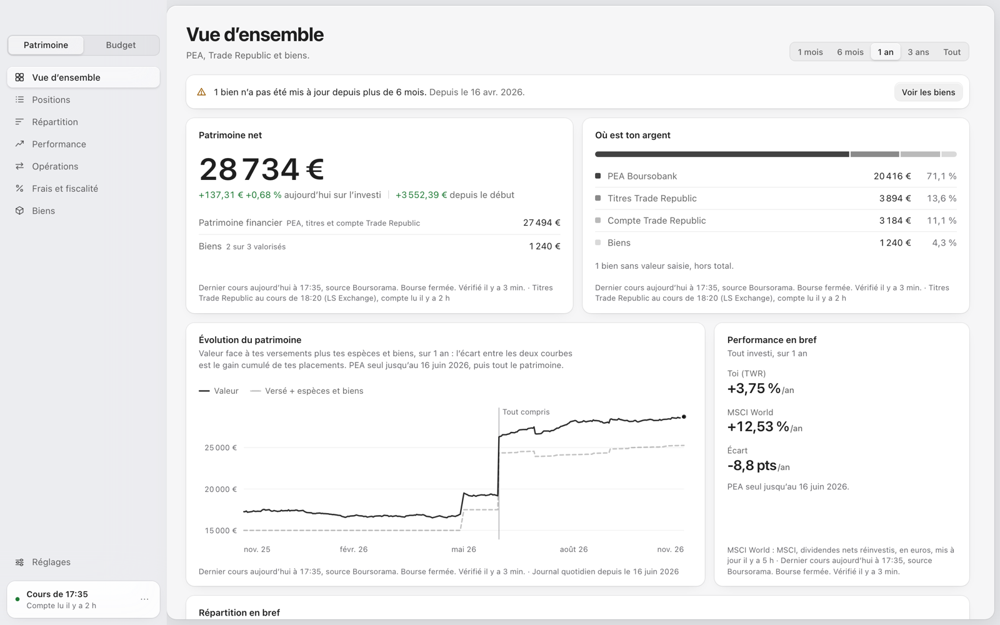
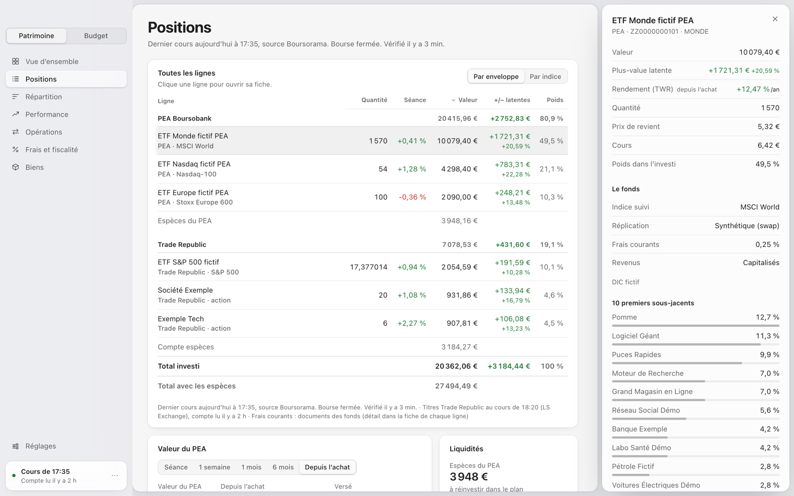

# Tracker

> Une app Mac personnelle pour suivre mon patrimoine (PEA, compte-titres, biens) et mes dépenses d'étudiant au même endroit, avec des chiffres justes et datés.

**Type** : app Mac (avec une version iPhone) · **Techno** : Tauri 2 (Rust), JavaScript sans framework, Claude · **Statut** : utilisé plusieurs fois par semaine · **Période** : novembre 2026

## Le problème
Mon argent est éclaté entre un PEA chez Boursobank, un compte-titres et un compte courant chez Trade Republic, et quelques biens. Je voulais voir au même endroit la valeur totale, la vraie performance face à un indice et mes dépenses du mois. Avec une règle de départ : des chiffres justes d'abord, et dire clairement quand une donnée manque ou date, jamais un montant faux qui a l'air vrai.

## Ce que fait l'outil
- **Patrimoine consolidé** : PEA (saisi opération par opération, comme sur le relevé), titres et espèces Trade Republic (lus automatiquement), biens saisis à la main. Les cours sont relus chaque minute pendant la séance.
- **Performance** : rendement pondéré par le temps (TWR) et rendement de mon argent (MWR, XIRR), comparés à un indice choisi (MSCI World, ACWI, S&P 500…), avec volatilité, perte maximale et contribution de chaque ligne.
- **Répartition réelle à travers les ETF** : zones, pays, secteurs, devises et premiers sous-jacents, d'après les compositions publiées par iShares, Amundi et MSCI. Plus une page frais et fiscalité (frais courants, règle des 5 ans et plafond du PEA).
- **Budget** : dépenses par catégorie, budgets, abonnements repérés d'après leur rythme, « reste à dépenser » et rythme du mois comparé à un mois habituel. Claude classe les marchands de carte ; les noms des bénéficiaires de virements ne lui sont jamais envoyés.
- **Rien d'inventé** : chaque chiffre affiche sa source et son heure ; une donnée absente s'affiche « – » avec sa raison.
- Un widget de bureau flouté au repos, et un export Markdown à la demande (⌘E) pour analyser mes finances avec Claude, sans aucun nom de virement.

## En images

*Espace Budget : reste à dépenser, rythme du mois et prochains prélèvements.*

*Toutes les lignes, et la fiche d'un ETF : plus-value, rendement, frais et sous-jacents.*

*Performance par période face au MSCI World, volatilité et contribution de chaque ligne.*

Captures faites sur la maquette du projet, avec des données entièrement fictives.

## Comment je l'ai construit
Je l'ai construit avec Claude Code : je décris le besoin et les règles, Claude Code écrit le code, et je vérifie chaque écran sur mes propres comptes. La première version était en Electron ; je l'ai fait migrer vers Tauri 2, avec un backend en Rust. Pour ce chantier, j'ai d'abord fait écrire des notes de recherche sourcées (fiscalité du PEA et du compte-titres, frais des deux courtiers, sources des compositions d'indices), puis un document « contrat » que chaque partie du code devait suivre, puis une revue qui a relevé des défauts précis, comme un prélèvement compté deux fois les mois de 31 jours. Les calculs de base sont écrits une seule fois en JavaScript : la version iPhone (SwiftUI) exécute le même code que l'app Mac. Le projet compte environ 6 500 lignes de JavaScript et 3 500 de Rust, environ 500 vérifications automatiques sur les calculs, et l'installeur n'installe jamais une version dont les tests ou l'essai de l'app construite sur de fausses données échouent. J'en retiens qu'un outil financier se juge d'abord à la justesse et à la fraîcheur de ses chiffres.

Code privé, démo possible sur demande.
