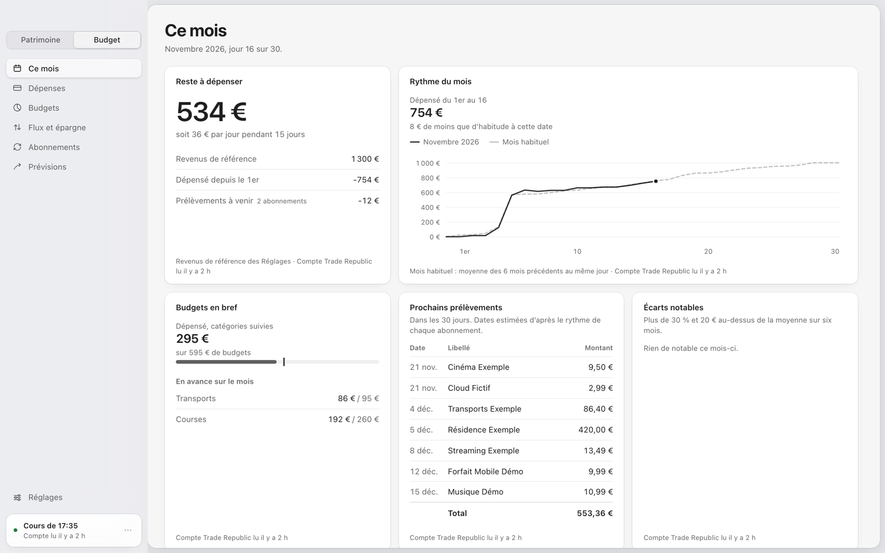
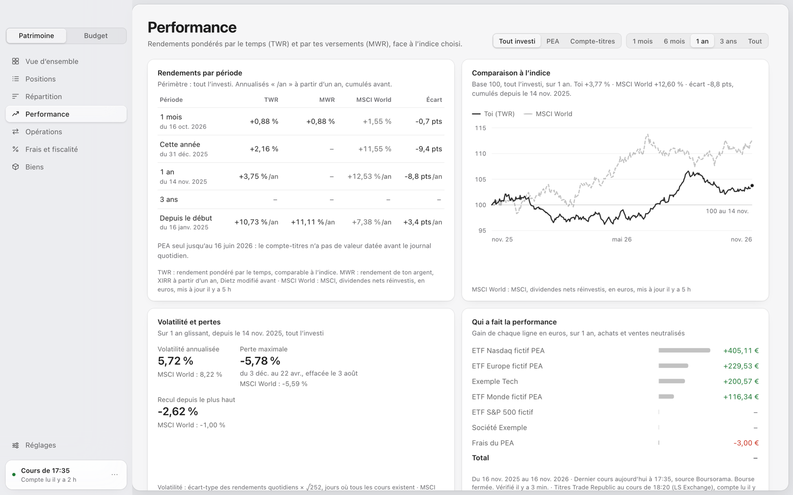

# Tracker

> Une app Mac personnelle pour suivre mon patrimoine (PEA, compte-titres, biens) et mes dépenses d'étudiant au même endroit, avec des chiffres justes et datés.

**Type** : app Mac (avec une version iPhone) · **Techno** : Tauri 2 (Rust), JavaScript sans framework, Claude · **Statut** : utilisé plusieurs fois par semaine · **Période** : novembre 2026

## Le problème
Mon argent est éclaté entre un PEA chez Boursobank, un compte-titres chez Trade Republic et quelques biens. Je voulais voir au même endroit la valeur totale, la vraie performance face à un indice et mes dépenses, avec des chiffres justes d'abord, jamais un montant faux qui a l'air vrai.

## Ce que fait l'outil
- **Patrimoine consolidé** : PEA saisi opération par opération, Trade Republic lu automatiquement, biens à la main.
- **Performance** : rendement pondéré par le temps (TWR) et de mon argent (MWR), face à un indice choisi.
- **Répartition réelle à travers les ETF** : zones, pays, secteurs, plus frais et fiscalité.
- **Budget** : dépenses par catégorie, abonnements repérés, « reste à dépenser ». Claude classe les marchands de carte, jamais les noms de bénéficiaires de virements.
- **Rien d'inventé** : chaque chiffre affiche sa source et son heure ; une donnée absente s'affiche « – ».

## En images

*Espace Budget : reste à dépenser.*

*Toutes les lignes, et la fiche d'un ETF.*

*Performance face au MSCI World.*

Captures faites sur la maquette du projet, avec des données entièrement fictives.

## Comment je l'ai construit
Je l'ai construit avec Claude Code : je décris le besoin et les règles, Claude Code écrit le code, et je vérifie chaque écran sur mes propres comptes. La première version était en Electron ; je l'ai migrée vers Tauri 2 (Rust), avec un document « contrat » et une revue qui a relevé un prélèvement compté deux fois les mois de 31 jours. Le projet compte environ 6 500 lignes de JavaScript, 3 500 de Rust et environ 500 vérifications automatiques . J'en retiens qu'un outil financier se juge d'abord à la justesse et à la fraîcheur de ses chiffres.

Code privé, démo possible sur demande.
