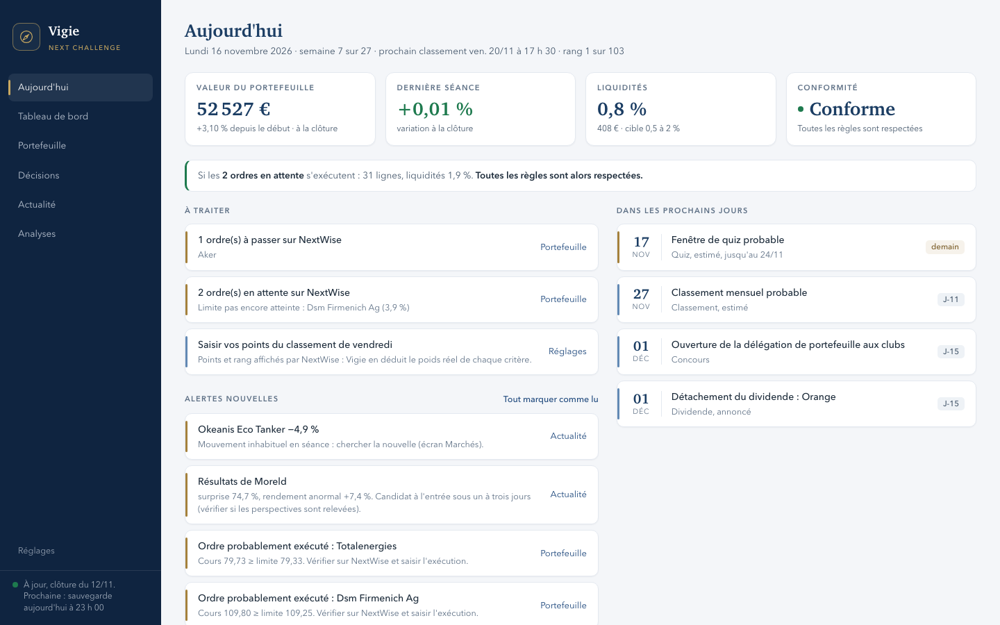
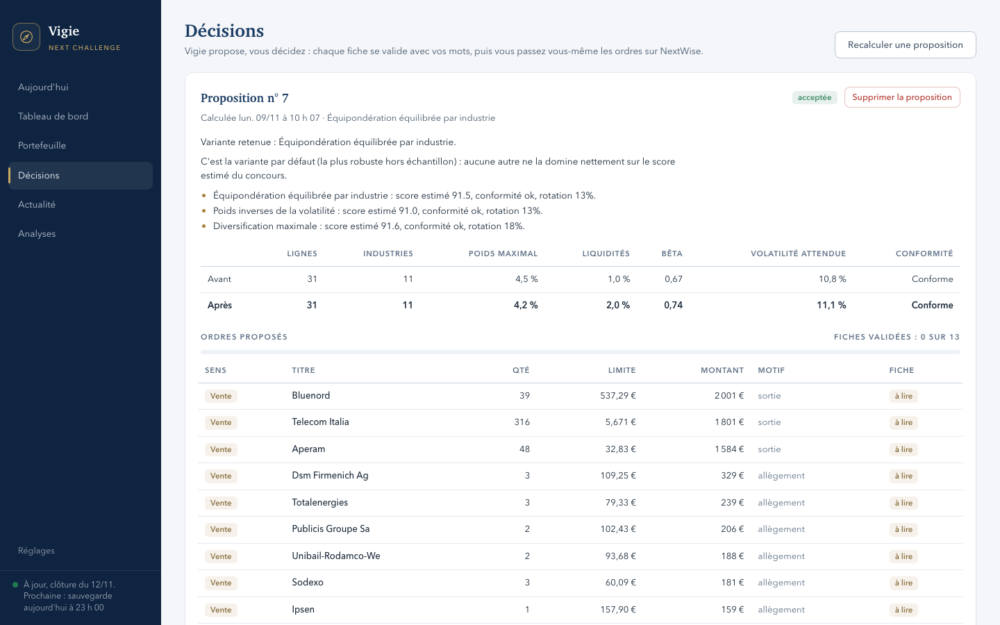
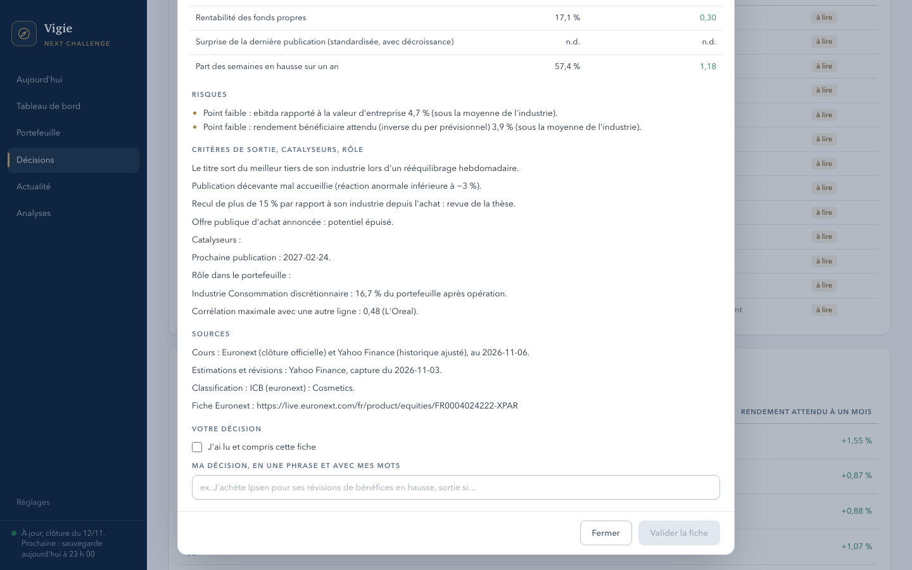
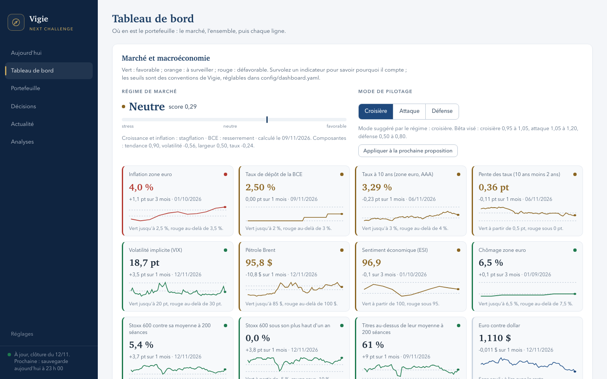

# Vigie

> Une aide à la décision sur mon Mac pour le concours de gestion de portefeuille Next Challenge 2026-2027 : elle analyse et prépare, je décide et passe les ordres moi-même.

**Type** : app Mac (Electron) avec interface web locale · **Techno** : Python, SQLite, Electron, Claude Code · **Statut** : utilisé au quotidien pendant le concours · **Période** : octobre 2026

## Le problème
Le Next Challenge confie à chaque étudiant 50 000 € virtuels à gérer d'octobre à avril, avec des règles de diversification et un barème non publié. Suivre seul des centaines de titres n'est pas tenable, et le règlement autorise l'IA pour analyser mais interdit tout programme qui agit sur la plateforme.

## Ce que fait l'outil
- Collecte chaque jour cours, actualités et indicateurs macro.
- Note chaque action face à son industrie et propose chaque semaine un rééquilibrage, avant et après.
- Contrôle la conformité aux règles du concours.
- Rédige une fiche de décision par ordre : thèse, risques, critères de sortie, sources datées.
- Fait travailler Claude en lecture seule (veille, critique de la proposition).

## L'outil prépare, je décide
Vigie ne se connecte jamais à NextWise : aucun identifiant stocké, aucun ordre passé à ma place. Je passe chaque ordre à la main, puis je le saisis. Une fiche ne se valide qu'après avoir reformulé la décision avec mes mots, et aucun chiffre n'est inventé : une donnée absente s'affiche « n.d. ».

## En images
| | |
|---|---|
|  |  |
| Proposition de la semaine | Fiche de décision |

*Tableau de bord : régime de marché et indicateurs macro.*

## Comment je l'ai construit
Je l'ai construit avec Claude Code : je pars d'un cahier des charges, Claude Code écrit le code lot par lot, et je vérifie sur mes ordres réels. Le projet compte environ 12 300 lignes de Python et 120 tests. Au classement du Transac' Challenge du 30 octobre 2026, le portefeuille était 1er sur 103 participants.

Code privé, démo possible sur demande.
